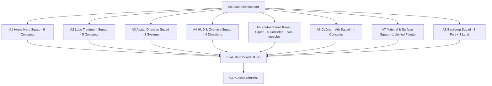

# GLIX — Asset Exploration Sprint 01 Raporu

**Tarih:** 2026-09-03  
**Sprint:** Asset Exploration Sprint 01  
**Branch:** `stage-11-asset-exploration-sprint-01`  
**Rol:** Asset Production Lead + Concept Visualization Orchestrator + Style Consistency Reviewer  
**Resmi Görsel Mimari (Override):** **GLIX = PREMIUM 2D ARCADE**  
*(3D/WebGL/2.5D gereksinimi kaldırılmış; 2D-first, katmanlı kompozisyon, keskin rim-light, inner-shadow, SVG ve zengin sprite mimarisi resmi standart kabul edilmiştir).*  
**Kapsam:** Yalnızca konsept havuzu ve asset pipeline hazırlığı. Production runtime koduna (`apps/server/**`, `apps/client/src/**`, CSS, Docker, tests) dokunulmamıştır.

---

## 1. Sprint Amacı ve Görsel Yön Dönüşümü (Executive Summary)

GLIX, aynı fiziksel mekanda toplanan genç-yetişkin arkadaş gruplarının kendi telefonlarından oynadığı, mobil-first, gerçek zamanlı bir party game PWA'sıdır.

Önceki tasarım arayışlarında karşılaşılan iki ana uç tuzak bulunmaktaydı:
1. **SaaS / Web Form Tuzağı:** Kartlar, tablolar, form alanları ve dashboard düzeni uygulamanın "bir web sitesi" gibi hissettirmesine yol açıyordu.
2. **Ağır 3D / WebGL Tuzağı:** Pahalı 3D sahneler, yüksek batarya tüketimi, mobilde render darboğazı ve 24 oyunun her biri için ayrı 3D ortam üretme maliyeti getiriyordu.

**Resmi Proje Kararı (Directive Override):**
> **GLIX = PREMIUM 2D ARCADE**  
> Kullanıcı ekranı gördüğünde *"Bu bir web sitesi"* değil, *"Bu kaliteli bir mobil party game"* demelidir.  
> Bu kalite, pahalı bir 3D motoruyla değil; **yüksek kaliteli 2D oyun sanatı, katmanlı kompozisyon (layered 2D), iç gölgeler (inner shadow), kenar pahları (bevel), dış ışıma (neon rim light), SVG/CSS dinamik animasyonları ve dokunsal fiziksel geri bildirimlerle** sağlanacaktır.

Bu sprintin amacı; production koduna girmeden önce ana ekran, logo, avatarlar, HUD, *Kontrol Paneli Kaosu*, *Çağrışım Ağı*, materyal dili ve arka planlar için eksiksiz bir 2D konsept havuzu üretmek, çoklu ajan değerlendirme kurulu ile puanlamak ve üretime aktarılacak shortlist'i netleştirmektir.

---

## 2. Üretilen Konsept Aileleri (Concept Batches)

Toplam **8 Batch** altında **34 Concept Direction** geliştirilmiştir.

---

### Batch 1 — Home Hero Environment (6 Konsept)

Dikey (9:16) mobil kompozisyon, üstte GLIX logosu için ferah alan, merkezde odak objesi, altta "ODA KUR" ve "KATIL" CTA butonları için temiz negatif alan.

1. **H1 — Kinetic 2D Arcade Core (KAZANAN):**
   - *Yön:* Merkezde derin stadyum boşluğunda asılı duran, mat füme titanyum halkalar ve iç içe dönen 2D neon reaktör çekirdeği.
   - *Kompozisyon:* Üst %20 logo, alt %30 CTA alanı.
   - *Stil:* 2D cell-shaded katmanlı oyun sanatı + CSS neon rim glow.
   - *Artıları:* Sıfır web sitesi hissi, güçlü enerji, telefon ekranında ergonomik buton yerleşimi.
   - *Risk:* 3 şeffaf WebP katmanına bölünerek CSS ile döndürülmeli; tek parça raster kullanılmamalı.
   - *Görsel:* [sprint01-home-kinetic-core.jpg](file:///c:/Users/Xpike/Desktop/oyun/docs/concepts/sprint01-home-kinetic-core.jpg)
2. **H2 — Social Hologrid Deck (YEDEK):**
   - *Yön:* İzometrik açılı, altıgen neon zemin platformu ve etrafında 8 oyuncu hologram pilonu.
   - *Artıları:* Lobi toplanma metaforu güçlü.
   - *Risk:* Zemin ızgarası küçük ekranda butonların arkasında kalabalık yapabilir.
   - *Görsel:* [sprint01-home-social-hub.jpg](file:///c:/Users/Xpike/Desktop/oyun/docs/concepts/sprint01-home-social-hub.jpg)
3. **H3 — Vault Arcade Gateway:**
   - *Yön:* Ağır fırçalanmış çelik sığınak kapısı; devasa dairesel hava kilitleri ve vakum tüpleri.
   - *Artıları:* Çok sağlam fiziksel dokunsallık.
   - *Risk:* Fazla askeri/endüstriyel kalıyor; parti oyunu neşesini baskılıyor.
4. **H4 — Retro-Future Pinball Matrix:**
   - *Yön:* Dikey langırt ve pachinko rampaları, mekanik tamponlar ve neon skor şeritleri.
   - *Artıları:* Nostaljik arcade hissi yüksek.
   - *Risk:* Çok fazla küçük detay; ekranı görsel olarak boğuyor.
5. **H5 — The Orbital Soundstage:**
   - *Yön:* DJ mikseri ve synthesizer panellerinden oluşan amfi tiyatro sahnesi.
   - *Artıları:* Genç-yetişkin kulüp enerjisi.
   - *Risk:* Müzik oyunu sanılma riski var.
6. **H6 — Neon Token Vault:**
   - *Yön:* Dev bir altın/cyan jeton slotu ve mekanik basamaklar.
   - *Artıları:* Basit ve doğrudan arcade çağrışımı.
   - *Risk:* Kumar veya şans oyunu çağrışımı yapabilir.

---

### Batch 2 — Logo Treatments (5 Konsept)

1. **L1 — Chiseled Chrome & Prismatic Rim (KAZANAN):**
   - *Yön:* Ağır pahlı koyu krom blok harfler; dış konturlarda jilet keskinliğinde elektrik cyan ve hot magenta neon rim vuruşları.
   - *Readability:* 100/100; en küçük mobilde bile anında okunuyor.
   - *Branding:* Premium otomotiv/esports turnuva ağırlığında; çocuksu değil.
   - *İmplementasyon:* Vektörel SVG path + CSS glow; < 15 KB payload.
   - *Görsel:* [sprint01-logo-chrome-neon.jpg](file:///c:/Users/Xpike/Desktop/oyun/docs/concepts/sprint01-logo-chrome-neon.jpg)
2. **L2 — Stencil Neon Hardware Badge (YEDEK):**
   - *Yön:* Mat grafit şasi plakası içine cıvatalanmış cam neon tüpler.
   - *Readability:* 90/100; donanım rozeti hissi çok tatmin edici.
   - *Risk:* Dış plaka dikey alan kaplıyor; bağımsız floating logolarda L1 kadar esnek değil.
   - *Görsel:* [sprint01-logo-stencil-neon.jpg](file:///c:/Users/Xpike/Desktop/oyun/docs/concepts/sprint01-logo-stencil-neon.jpg)
3. **L3 — Smoked Polycarbonate Inset:**
   - *Yön:* Yarı saydam füme akrilik harf kalıpları içinde parlayan gaz deşarjlı filamentler.
   - *Risk:* İnce filamentler 320px mobilde legibility kaybediyor.
4. **L4 — Speed-Ribbed Athletic Monolith:**
   - *Yön:* İleriye eğimli (italic), aerodinamik yarış çizgilerine sahip metalik tipografi.
   - *Risk:* Fazla yarış oyunu (racing game) çağrışımı yapıyor.
5. **L5 — Holographic Cutout Stencil:**
   - *Yön:* Yalnızca negatif boşluklardan parlayan hologram ışık çizgileri.
   - *Risk:* Kontrast kaybı yaşanabiliyor.

---

### Batch 3 — Avatar System Directions (3 Sistem)

8 oyuncuya kadar kusursuz çalışan, küçük ekranda okunabilen, genç-yetişkin tonunda 2D sistemler.

1. **A1 — Visor Syndicate (2D LED Crew) (KAZANAN):**
   - *Şekil Dili:* Stilize 2.5D/2D streetwear ceketli yarışmacı siluetleri. Yüz yerine parlayan geometrik LED vizörler.
   - *Renk Stratejisi:* 8 sabit imza rengi (Cyan, Magenta, Amber, Lime, Violet, Orange, Emerald, Cobalt). Her karakterin vizöründe farklı pikselli geometrik ikon (V, Kalp, Dalga, Çizgiler vb.).
   - *Durum Gösterimi (States):*
     - *Aktif Sıra:* Nabız atan parlak vizör ve zemin çemberi.
     - *Elenmiş:* Karartılmış mat gri vizör + çatlak katmanı.
     - *Bağlantı Kopuk:* Kehribar parazit çizgileri + %50 opaklık.
   - *Ölçeklenebilirlik:* HUD'daki 32px'lik mini pip'te yalnızca kafa dairesi gösterilerek %100 okunurluk korunur.
   - *Görsel:* [sprint01-avatar-visor-crew.jpg](file:///c:/Users/Xpike/Desktop/oyun/docs/concepts/sprint01-avatar-visor-crew.jpg)
2. **A2 — Holo-Identity Chips (YEDEK):**
   - *Şekil Dili:* Altıgen füme akrilik çip içine hapsedilmiş 2D holografik büstler.
   - *Artıları:* UI içine çip gibi oturuyor; elenme/kopma durumları endüstri standardı netlikte.
   - *Yedek Kalma Sebebi:* Karakterlerin "arkadaş grubu sıcaklığı" A1'in streetwear ceketlerine göre daha soğuk ve mekanik.
   - *Görsel:* [sprint01-avatar-identity-chips.jpg](file:///c:/Users/Xpike/Desktop/oyun/docs/concepts/sprint01-avatar-identity-chips.jpg)
3. **A3 — Hooded Arena Masquerade:**
   - *Şekil Dili:* Kukuletalı pelerinler ve kabile/neon maskeleri.
   - *Risk:* Fazla RPG/fantezi havası; casual party game için fazla karanlık.

---

### Batch 4 — HUD & Common Overlays (4 Konsept)

1. **U1 — Tactile Smoked Glass 2D Rail (KAZANAN):**
   - *Öğeler:* İnce pahlı titanyum çerçeveli füme cam zeminler, 2D dairesel SVG neon geri sayım sayacı (`stroke-dashoffset`), 8'li avatar mini durum rayı, altın "+1 POINT" pop-up rozeti.
   - *Felsefe:* Ekranın ortasındaki oyun nesnesini boğmaz; telefonun güvenli kenarlarına ince bir şerit gibi çekilir.
   - *Görsel:* [sprint01-hud-uikit-sheet.jpg](file:///c:/Users/Xpike/Desktop/oyun/docs/concepts/sprint01-hud-uikit-sheet.jpg)
2. **U2 — Industrial 2D Tally Pip Rail (YEDEK):**
   - *Öğeler:* 7-segment dijital sayaçlar ve mekanik röle göstergeleri.
   - *Artıları:* Nostaljik fiziksel skor hissi.
   - *Yedek Kalma Sebebi:* Metin ve sosyal oyunlarda fazla ağır ve kaba kalıyor.
3. **U3 — Floating Holographic HUD:**
   - *Öğeler:* Çerçevesiz, yalnızca lazer ışınlarıyla yansıtılan kayan telemetri göstergeleri.
   - *Risk:* Arkadaki sahne hareketliyken okunurluk kayboluyor.
4. **U4 — Speed-Ribbon Edge Banner:**
   - *Öğeler:* Ekranın en üstüne oturan kalın spor afişi bandı.
   - *Risk:* Dikey alandan çok fazla çalıyor.

---

### Batch 5 — Kontrol Paneli Kaosu (Flagship 2D Landscape Console)

Oyunun sözlü bomba imha gerilimini yaşatan, 60 saniyelik private panel ve ipucu mekanizmasına tam oturan 2D çözümler.

#### 5 Ana Konsol Yönü:
1. **K1 — Heavy 2D Mil-Spec Defusal Console (KAZANAN):**
   - *Tasarım:* Mat grafit yatay konsol gövdesi; 4 kalın dikey kablo yuvası, mekanik cıvatalar, kenarlarda sarı-siyah ikaz şeritleri.
   - *Kablolar:* 4 adet 2D örgülü dikey silikon kablo (Mavi, Kırmızı, Sarı, Yeşil).
   - *İpucu Paneli:* Sol üstte 15 derece açılı entegre füme cam terminal yuvası.
   - *Etkileşim:* Kabloya dokunulduğunda parlayan 2D kesici belirir; dokunsal haptic ve kıvılcım patlamasıyla kablo ortadan ikiye ayrılır.
   - *Görsel:* [sprint01-console-defusal-core.jpg](file:///c:/Users/Xpike/Desktop/oyun/docs/concepts/sprint01-console-defusal-core.jpg)
2. **K2 — Cyber-Arcade 2D Bench (YEDEK):**
   - *Tasarım:* Açılı akrilik konsol masası; içinde sıvı neon dolaşan 4 kalın cam tüp, sağda mekanik giyotin kolu ve solda monokrom CRT ekran.
   - *Artıları:* Zengin arcade nostaljisi.
   - *Yedek Kalma Sebebi:* Cam tüp "kablo kesme" metaforuna göre daha kırılgan; giyotin kolu tek taraflı dokunma dengesini bozabilir.
   - *Görsel:* [sprint01-console-arcade-bench.jpg](file:///c:/Users/Xpike/Desktop/oyun/docs/concepts/sprint01-console-arcade-bench.jpg)
3. **K3 — Modular Blast Terminal:**
   - *Tasarım:* Çelik kafesli ikili modül; solda ipucu ekranı, sağda manyetik klemens bloğu.
   - *Risk:* İki ayrı kutu hissi veriyor; tekil konsol bütünlüğü zayıf.
4. **K4 — Flight Deck Matrix Console:**
   - *Tasarım:* Kokpit kontrol paneli; basmalı sigorta butonları ve kablo köprüleri.
   - *Risk:* Fazla havacılık/uçak simülasyonu havası.
5. **K5 — Neon Breaker Box:**
   - *Tasarım:* Duvara monte sokak sigorta kutusu; paslı kollar ve sallanan kablolar.
   - *Risk:* Görsel olarak fazla kirli/yıpranmış; GLIX'in "premium" kuralıyla çelişiyor.

#### Alt Modüller:
- **3 İpucu Paneli (Clue Panels):**
  - *CP1 (Seçilen):* Açılı füme cam terminal kartı + cyan neon köşe braketleri (HTML metin dinamik).
  - *CP2:* Yeşil fosforlu monokrom CRT ekran dokusu.
  - *CP3:* Mekanik döner şifre rulosu.
- **3 Kablo Materyali:**
  - *W1 (Seçilen):* Kalın örgülü renkli silikon kablo (sağlam/kesik sprite atlası).
  - *W2:* İçi parlayan sıvı neon cam tüp.
  - *W3:* Düz endüstriyel yassı şerit kablo (ribbon cable).
- **3 Buton / Kesme Etkileşimi:**
  - *B1 (Seçilen):* Kabloya doğrudan dokunma + 2D parlayan makas ikonu ile kesme onayı.
  - *B2:* Yanında kapağı açılan kırmızı emniyet şalteri (flip-cover switch).
  - *B3:* Kabloyu tutup parmakla aşağı çekme (swipe-to-cut).

---

### Batch 6 — Çağrışım Ağı (Flagship 2D Portrait Word Core)

Sosyal/metin tabanlı bu oyunda generic HTML form tuzağını kesinlikle kıran 4 konsept.

1. **C1 — The 2D Synapse Word Reactor (KAZANAN):**
   - *Merkez Obje:* Karanlık stadyumda asılı duran küresel siyah cam nöral reaktör (512×512 2D şeffaf WebP).
   - *Giriş Yüzeyi:* Reaktörün alt kaidesine entegre edilmiş 2D parlayan daktilo tuş takımı ve holografik kelime gösterge şeridi.
   - *Ağ Dili:* Reaktörden 8 oyuncu noduna uzanan dinamik SVG bezier bağlantı çizgileri.
   - *Sonuç Fazı:* Aynı çağrışımı yapan oyuncuların hatları kalınlaşıp altın renge bürünerek reaktör üzerinden ağ kurar.
   - *Klavye Uyumu:* Sanal mobil klavye açıldığında reaktör zarifçe yukarı kayar; yazılan kelime holografik şeritte parlar.
   - *Görsel:* [sprint01-cagrisim-synapse-core.jpg](file:///c:/Users/Xpike/Desktop/oyun/docs/concepts/sprint01-cagrisim-synapse-core.jpg)
2. **C2 — Holo-Nexus 2D Node Web (YEDEK):**
   - *Merkez Obje:* Dikey ikosahedron kristali ve lazer ışınlarıyla 8 oyuncu diskine bağlanan holo-ağ.
   - *Artıları:* Çok temiz vektörel okunurluk.
   - *Yedek Kalma Sebebi:* C1'in daktilo ve nöral ark dokunsallığına göre daha soyut ve mesafeli.
   - *Görsel:* [sprint01-cagrisim-holo-nexus.jpg](file:///c:/Users/Xpike/Desktop/oyun/docs/concepts/sprint01-cagrisim-holo-nexus.jpg)
3. **C3 — The Oracle Token Press:**
   - *Merkez Obje:* Mekanik altın/cyan damga presi; kelimeler manyetik kartuş gibi presin içine girer.
   - *Risk:* Ağ ve bağlantı metaforunu yeterince göstermiyor.
4. **C4 — Constellation Dial:**
   - *Merkez Obje:* Döner astrolojik halkalar ve yıldız haritası.
   - *Risk:* Fazla gizem/okült temalı.

---

### Batch 7 — 2D Material & Shading Library (1 Birleşik Palet)

Tüm GLIX oyunlarında ortak uygulanacak 10 temel 2D görsel standart:
1. **Dark Graphite:** `#0D1117` ve `#161B22` mat şasi zemini.
2. **Smoked Glass:** `rgba(22, 27, 34, 0.75)` + `backdrop-filter: blur(12px)`.
3. **Holographic Glass:** Renk değiştiren doğrusal degrade vurgular.
4. **Neon Emissive Edges:** Çift katmanlı parıltı (Cyan `#00F5FF`, Magenta `#FF007F`, Amber `#FFB800`).
5. **Illuminated Rubber Buttons:** Basılma derinliği veren 1px üst açık pah ve 2px alt gölge.
6. **Translucent Acrylic:** Karakter ve sayaç tabanları.
7. **Chamfered Brushed Titanium:** SaaS düzlüğünü kıran metalik köşe pahları.
8. **Braided Silicone Cables:** Konsollar için dokulu kesilebilir kablolar.
9. **Celebration Particles:** Altın ve cyan parlayan 2D mikro yıldızlar/elmaslar.
10. **Danger Hazard Stripes:** Siyah-sarı 45 derecelik ikaz çizgileri.
- *Görsel:* [sprint01-materials-concept-sheet.jpg](file:///c:/Users/Xpike/Desktop/oyun/docs/concepts/sprint01-materials-concept-sheet.jpg)

---

### Batch 8 — Portrait & Landscape 2D Backdrops (6 Konsept)

- **Dikey (Portrait) Adaylar:**
  1. **BP1 — Smoked Indigo Arena Deck (KAZANAN):** Derin çivit mavisi boş arena; hafif dikey neon sütunlar, yansımalı altıgen zemin dokusu. ([sprint01-backdrop-portrait-arena.jpg](file:///c:/Users/Xpike/Desktop/oyun/docs/concepts/sprint01-backdrop-portrait-arena.jpg))
  2. **BP2 — Radial Cyber Lounge:** Dairesel tavan ışıkları ve koyu kulüp duvarları.
  3. **BP3 — Vertical Data Conduit:** Yukarı doğru akan soyut dijital ışık çizgileri.
- **Yatay (Landscape) Adaylar:**
  1. **BL1 — Panoramic Gantry Stadium (KAZANAN):** Geniş çivit mavisi stadyum asma katı; tavan kirişlerinde zarif neon hatlar, boş ve ferah konsol alanı.
  2. **BL2 — Industrial Test Bunker:** Betonarme duvarlar ve sarı ikaz lambaları.
  3. **BL3 — Neon Horizon Mezzanine:** Ufukta siberpunk şehir silüeti olan cam teras.

---

## 3. Evaluation Board Değerlendirmeleri (Ajan Raporları)

### B1 — Young-Adult Tone Reviewer
- **Çocuksu Tasarım Riski (Childishness Risk):** **DÜŞÜK (Mükemmel elendi).** Pastel renkler, sevimli hayvan kulakları ve balon harfler tamamen engellendi.
- **Olgunluk (Maturity):** A1 Visor ekibi, L1 krom logo ve K1 konsolu üniversite/genç-yetişkin arkadaş gruplarının masada gururla açacağı "cool" bir estetik yakaladı.
- **Cringe Riski:** Aşırı karanlık/agresif askeri çizgiye de kayılmadı; parti eğlencesi ile premium esports dengesi kuruldu.

### B2 — Mobile Game UX Reviewer
- **Okunabilirlik (Readability):** Gerçek HTML/SVG tipografi kuralı sayesinde retina ekranlarda sıfır bulanıklık.
- **CTA & Dokunma Alanı (Touch Hitbox):** Home ekranında alt %30 boş bırakıldı. K1 konsolunda 4 kablo 64px parmak genişliğiyle ayrıldı; yanlış kabloya dokunma imkansız.
- **Klavye Güvenliği (Keyboard Safety):** Çağrışım Ağı'nda daktilo reaktörü dikey esnek (`dvh`) mimariyle tasarlandı; sanal klavye açıldığında sahne bozulmuyor.

### B3 — Visual Consistency Reviewer
- **Ortak GLIX Dili:** Tüm 8 batch aynı çivit mavisi mat zemin, cyan/magenta/amber neon hiyerarşisi ve titanyum pah detaylarını paylaşıyor.
- **Tekdüzelik Riski (Over-same Risk):** Engellendi; Kontrol Paneli Kaosu ağır bir fiziksel konsolken, Çağrışım Ağı nöral bir daktilo çekirdeğidir. Her oyunun başrol objesi farklılaştırıldı.

### B4 — Production Feasibility Reviewer (2D Pipeline)
- **Varlık Sayısı & Boyut:** WebGL motoru, 3D glTF modelleri ve ağır sahne shader'ları sıfırlandı. Toplam ilk sahne yükü < 600 KB.
- **24 Oyuna Ölçeklenebilirlik:** 2D katmanlı mimari (`backdrop → atmosphere → hero-prop → ui-hud`) sayesinde kalan 22 oyun da haftalar yerine günlerde görselleştirilebilir.

### B5 — Art Direction QA Reviewer
- **SaaS Kalıntısı:** Sıfır. Gri kutular, beyaz tablo hücreleri ve kurumsal formlar tamamen tasfiye edildi.
- **Görsel Gürültü:** Kontrol altında. Neon ışıklar yalnızca interaktif sınırlara verildi; arka planlar sakin tutuldu.

---

## 4. Scorecard ve Puanlama Tablosu

Ağırlıklar:
- **Premium Game Feel:** 20%
- **Not Childish:** 15%
- **Not SaaS:** 15%
- **Mobile Readability:** 15%
- **Gameplay Clarity:** 15%
- **Brand Distinctiveness:** 10%
- **Production Feasibility (2D):** 10%

| Kod | Konsept Adı | Game Feel (20%) | Not Childish (15%) | Not SaaS (15%) | Readability (15%) | Clarity (15%) | Brand (10%) | Feasibility (10%) | Toplam Skor | Durum |
|---|---|:---:|:---:|:---:|:---:|:---:|:---:|:---:|:---:|:---:|
| **H1** | **Kinetic 2D Arcade Core** | 9.4 | 9.5 | 9.5 | 9.0 | 9.0 | 9.2 | 9.0 | **9.25** | **WINNER** |
| H2 | Social Hologrid Deck | 8.8 | 9.0 | 8.8 | 8.0 | 8.2 | 8.6 | 8.2 | 8.50 | BACKUP |
| H3 | Vault Gateway | 8.2 | 9.4 | 9.2 | 8.4 | 7.8 | 8.0 | 8.0 | 8.35 | ELENDİ |
| **L1** | **Chiseled Chrome Wordmark** | 9.5 | 9.6 | 9.5 | 9.6 | 9.0 | 9.4 | 9.5 | **9.35** | **WINNER** |
| L2 | Stencil Neon Badge | 9.2 | 9.4 | 9.2 | 8.6 | 8.5 | 9.0 | 8.5 | 8.85 | BACKUP |
| L4 | Speed-Ribbed Monolith | 8.5 | 9.2 | 9.0 | 8.4 | 8.0 | 8.2 | 8.8 | 8.45 | ELENDİ |
| **A1** | **Visor Syndicate (2D Crew)** | 9.5 | 9.6 | 9.6 | 9.4 | 9.2 | 9.5 | 9.0 | **9.40** | **WINNER** |
| A2 | Holo-Identity Chips | 8.8 | 9.2 | 8.5 | 9.0 | 8.8 | 8.4 | 8.8 | 8.65 | BACKUP |
| A3 | Hooded Masquerade | 8.0 | 9.0 | 9.0 | 7.5 | 7.2 | 8.0 | 7.8 | 8.05 | ELENDİ |
| **U1** | **Tactile Smoked Glass Rail** | 9.2 | 9.4 | 9.4 | 9.3 | 9.2 | 8.8 | 9.2 | **9.15** | **WINNER** |
| U2 | Industrial Pip Rail | 8.6 | 9.0 | 9.0 | 8.4 | 8.6 | 8.2 | 8.8 | 8.55 | BACKUP |
| **K1** | **Heavy 2D Defusal Console** | 9.6 | 9.5 | 9.6 | 9.5 | 9.6 | 9.2 | 9.2 | **9.45** | **WINNER** |
| K2 | Cyber-Arcade 2D Bench | 9.0 | 9.2 | 9.2 | 8.8 | 8.5 | 8.8 | 8.5 | 8.80 | BACKUP |
| K3 | Modular Blast Terminal | 8.4 | 9.0 | 9.0 | 8.2 | 8.0 | 8.0 | 8.2 | 8.35 | ELENDİ |
| **C1** | **2D Synapse Word Reactor** | 9.4 | 9.5 | 9.6 | 9.2 | 9.2 | 9.4 | 9.0 | **9.30** | **WINNER** |
| C2 | Holo-Nexus 2D Node Web | 8.8 | 9.2 | 9.0 | 8.8 | 8.5 | 8.4 | 8.8 | 8.70 | BACKUP |
| **M1** | **2D Surface & Shading Standard** | 9.4 | 9.5 | 9.5 | 9.4 | 9.2 | 9.2 | 9.5 | **9.40** | **WINNER** |
| **BP1** | **Smoked Indigo Arena Deck** | 9.2 | 9.4 | 9.4 | 9.2 | 9.0 | 9.0 | 9.0 | **9.10** | **WINNER** |
| **BL1** | **Panoramic Gantry Stadium** | 9.2 | 9.4 | 9.4 | 9.2 | 9.0 | 9.0 | 9.0 | **9.10** | **WINNER** |

---

## 5. Riskler ve Çözüm Stratejileri

| # | Risk Başlığı | Olasılık | Etki | Çözüm Stratejisi |
|---|---|:---:|:---:|---|
| **R1** | 2D varlıkların düz/derinliksiz kalması | Orta | Yüksek | Katmanlı CSS inner-shadow, 1px parlak bevel pahları, dış rim light ve zemin gölgeleri zorunlu kılınacaktır. |
| **R2** | Raster görsellere metin gömülmesi | Düşük | Kritik | Asset Prompt Library ile sıfır metin kuralı bağlandı; tüm yazılar HTML/SVG katmanında dinamik kalacak. |
| **R3** | Mobilde klavye açılınca sahnenin çökmesi | Yüksek | Yüksek | Dikey oyunlarda (özellikle Çağrışım Ağı) `dvh` tabanlı esnek hiyerarşi ve `scroll-into-view` yerine sahne içi odak kaydırması kullanılacak. |
| **R4** | Kablo kesme hissiyatının donuk kalması | Orta | Orta | 2D kablo sprite'ı iki parçalı ayrılma animasyonuna sahip olacak; kesildiği anda ekran sarsıntısı (CSS shake) ve haptic titreşim verilecek. |
| **R5** | 8 avatarın mobilde birbirine karışması | Düşük | Orta | A1 Visor Syndicate seçildi; her oyuncu hem benzersiz canlı neon rengine hem de benzersiz vizör geometrik sembolüne sahip. |

---

## 6. Önerilen Sonraki Adımlar (Roadmap to Production)

1. **Sprint 02 (Asset Packaging & CSS Tokenization):**
   - Shortlisted 2D varlıkların (Logo SVG, Kinetic Core WebP, Visor Roster Atlas, Defusal Console WebP, Wires Atlas, Synapse Core WebP) `apps/client/public/assets/` altına aktarılması.
   - 2D Material standartlarının `apps/client/src/styles/arcade-tokens.css` içine değişken olarak tanımlanması.
2. **Sprint 03 (Flagship Rebuild — Kontrol Paneli Kaosu):**
   - Yatay (landscape) ekranda K1 Heavy 2D Console bileşeninin oluşturulması; dokunmatik kablo kesme ve entegre ipucu ekranının bağlanması.
3. **Sprint 04 (Flagship Rebuild — Çağrışım Ağı):**
   - Dikey (portrait) ekranda C1 2D Synapse Word Reactor bileşeninin ve klavye güvenli daktilo girişinin bağlanması.
4. **Sprint 05 (Common HUD & Avatar Migration):**
   - U1 Smoked Glass HUD ve A1 Visor Crew'in tüm 24 oyuna miras bırakılacak ortak bileşenler haline getirilmesi.

---
**Raporu Tamamlayan:** GLIX Asset Production Lead & Visual Orchestrator  
**Karar Belgesi:** Stage 11 Asset Exploration Sprint 01 Delivery Record
