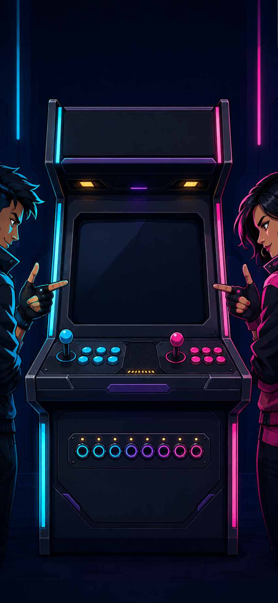
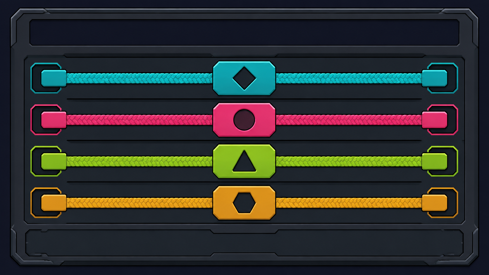
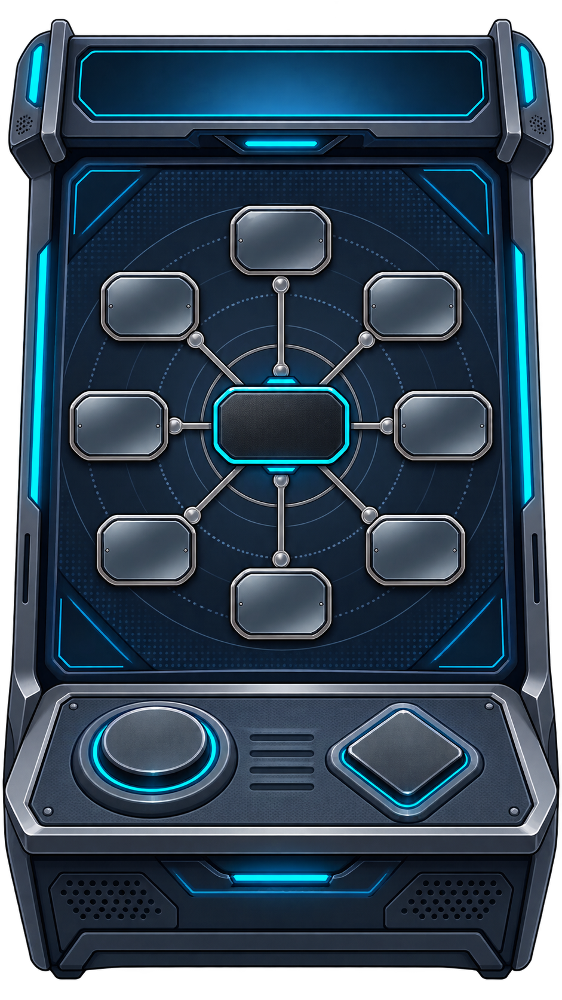
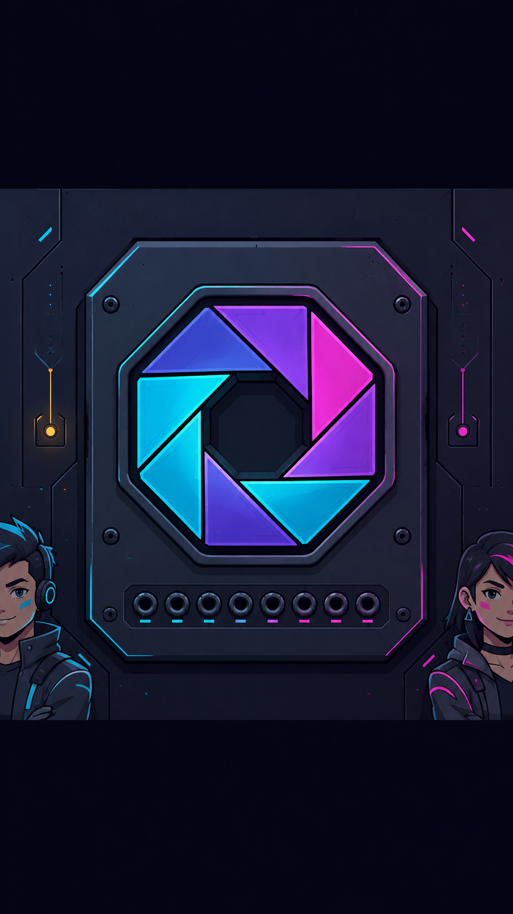
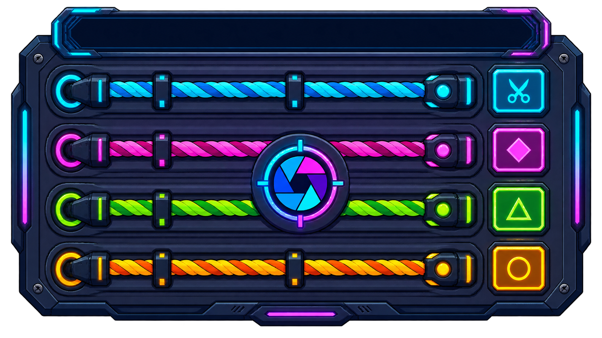
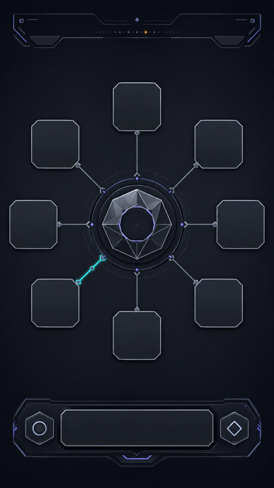
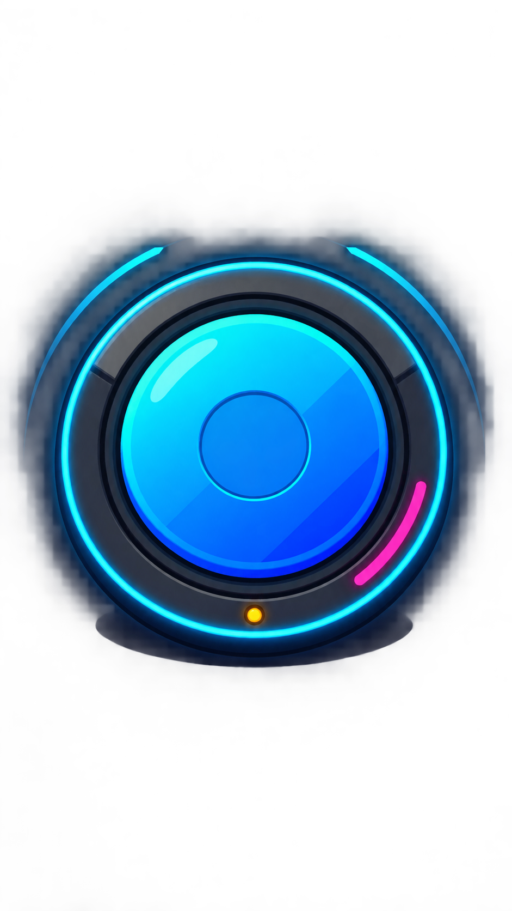

# GLIX — Creative Directions & Asset Exploration

**Durum:** FINAL DIRECTION CONTRACT / C6 corrective pass recorded  
**Tarih:** 2026-09-03  
**Resmi görsel hedef:** **GLIX = PREMIUM 2D ARCADE**  
**Kapsam:** Creative direction, 2D asset exploration, visual UX ve üretim handoff.  
**Runtime kapsamı:** Yok. `apps/**`, `packages/**`, runtime CSS, server/shared code ve canlı asset binding bu çalışma kapsamında değiştirilmez.

## 0. Otorite, override ve audit sınırı

Bu belge, `C:\Users\Xpike\Downloads\GLIX_CREATIVE_DIRECTION_ASSET_PROMPT.md` dosyasının tamamını ana execution/acceptance contract olarak kabul eder. Daha sonra gelen kullanıcı override’ı daha yüksek önceliklidir:

> GLIX’in resmi görsel hedefi **Premium 2D Arcade**’dır. Core gameplay, HUD, interaction surface, game-specific object ve avatarlar 2D-first olmalıdır. UI text gerçek HTML/SVG olarak kalmalıdır. Katmanlı 2D kompozisyon, shadow, inner shadow, bevel, rim light, gradient, sınırlı parallax, sprite/SVG animation, particles ve gerekli ise Canvas yalnızca 2D kalite/motion araçlarıdır.

Bu nedenle eski prompt veya repository kayıtlarındaki `2.5D`, gerçek zamanlı `3D scene`, `WebGL layer`, volumetric/photorealistic scene ve 3D asset pipeline ifadeleri yeni ana yön değildir. Bunlar yalnız tarihsel audit bağlamında anılır; yeni concept, Visual Bible veya asset handoff için hedef olarak seçilmez.

### İncelenen baseline

- `main` ve `origin/main` audit noktası: `2118d9a` — `fix: stabilize multiplayer participants and reconnects`.
- Mevcut production runtime, shared/server state, oyun adapter’ları, catalog, orientation ve private-state sınırları read-only incelendi.
- Mevcut konsept/asset kayıtları incelendi: `docs/concepts/**`, `docs/GLIX_ASSET_SHORTLIST.md`, `docs/GLIX_VISUAL_BIBLE.md`, `docs/GAME_VISUAL_SPEC_24.md`, `docs/ASSET-PIPELINE-NEON-TOYBOX.md`, `apps/client/src/App.tsx`, `apps/client/src/styles.css`, `apps/client/src/visuals/**`.
- Mevcut home’un audit gerçeği: logo/hero/copy/CTA hiyerarşisi canlı UI’dadır; yeni concept’ler `ODA KUR`, `KATIL` ve `NASIL OYNANIR` için güvenli, boş ve okunabilir alan bırakmalıdır.
- Mevcut game gerçeği: 24 oyun, 2–8 oyuncu; `Rus Ruleti`, `Kör Bomba` ve `Kontrol Paneli Kaosu` landscape; diğer 21 oyun portrait-safe; `Kontrol Paneli Kaosu` private panel/clue sınırına sahiptir.

### Bu exploration’da yapılmayanlar

- Ana ekran implementation’ı, `GameViewport`, production CSS/runtime refactor’ı, asset manifest binding’i, server/shared değişikliği ve 24 oyunun rebuild’i yapılmadı.
- Konsept PNG’leri yalnızca `docs/concepts/**` altında referanstır; `apps/client/public/**` veya runtime’a bağlanmaz.

## 1. Ortak GLIX 2D language

Oyuncunun ilk okuması “web sitesi” değil, “kaliteli mobil party game” olmalıdır. Bunu sağlayan ortak dil:

- **Game-first:** Her ekranda bir 2D hero object ve tek bir primary verb.
- **Physical arcade feel:** Grafit chassis, chamfered plates, smoked inset, rubber/button yüzeyi, temas gölgesi ve press/rebound feedback.
- **Young-adult:** Human-forward 2D crew, çağdaş streetwear, ölçülü attitude; bebek yüz, chibi oran, oyuncak/plush ve sürekli mascot gösterisi yok.
- **Premium:** Keskin silhouette, sınırlı bevel, kontrollü rim light, yüksek kontrast, düşük ama anlamlı glow.
- **Mobile-readable:** Portrait-first home/lobby; 320×700 safe read; long Turkish text live HTML/SVG; 44×44 logical hit target; scroll’suz primary action.
- **2D-first asset order:** SVG → transparent PNG/WebP → layered 2D background → gerektiğinde sprite sheet → procedural CSS/SVG → clear gameplay benefit varsa Canvas.
- **Live text:** Logo, CTA, game title, nickname, timer, score, clue ve tutorial text’i raster görsele gömülmez.
- **Information safety:** Public marker yalnız public ready/turn/alive/submitted durumunu taşır; private role, target, answer, poison, risk veya secret timer ima edilmez.

### Ortak layer order

```text
2D backdrop
  → 2D atmosphere / restrained parallax strips
  → game-specific 2D hero object
  → 2D interaction surface / transparent sprites
  → 2D avatars + public state markers
  → live SVG/HTML text + compact HUD rail
  → local feedback / result reveal / bounded particles
```

Bu bir 3D scene graph değildir. Ayrı üretilebilir 2D yüzeylerin responsive yerleşim sırasıdır. Dekoratif sahne gameplay input’unun üstüne çıkamaz.

## 2. Multi-agent exploration protocol

### C1–C5 independent directions

C1–C5 ilk exploration turunda birbirinden bağımsız creative sub-agent’lara verildi; her biri contract, current concepts ve repo sınırlarını read-only değerlendirdi. Kullanıcı override’ından sonra C1, C2, C3, C4 ve C5 için fresh 2D-first pass tamamlandı. Önceki usage-limit hatası sonrası C4/C5 tekrar ayrı ajan çağrılarıyla alındı; bu nedenle artık beş yönün de override memosu bağımsız girdiye sahiptir.

| Direction | Core proposition | 2D override sonucu |
|---|---|---|
| **C1 — Premium Arcade Machine** | Tek front-facing illustrated cabinet ve tactile hardware. | Cabinet artık 2D layered chassis/faceplate/sprite ailesidir; camera perspective, volumetric scene ve renderer yoktur. |
| **C2 — Neon Social Arena** | Sparse social core, 2–8 player marker’ı ve mekanik reaction glyph’leri. | Kalabalık değil; radial/edge marker sistemi ve tek social core. |
| **C3 — Planar Prism Party Core** | Planar prism/iris, node/ring motion ve visible mechanical anchor. | Glass/orb hacmi değil; SVG-like planar emblem + transparent sprite + CSS/SVG motion. |
| **C4 — Dark Game Show** | Controlled spotlight, competitive phase beat’i ve clear object focus. | Timer/HUD her oyuna zorlanmaz; sosyal/text oyunlarda sakin, object-led varyantlar kullanılır. |
| **C5 — Minimal Neon Console** | Tek console shell, faceplate family, büyük touch zone ve 8 marker socket. | Mobile/asset guardrail’i olarak tutulur; SaaS/device-demo riski nedeniyle final winner değildir. |

## 3. Direction cards — C1–C5

Her card contract’ın istediği 12 alanı içerir. Palette’ler aynı GLIX night/surface/text token ailesinden gelir; her hero’da iki ana neon hue sınırı korunur.

### C1 — Premium Arcade Machine

1. **One-line Art Direction:** Front-facing illustrated arcade cabinet, graphite hardware, layered faceplates, tactile controls and human-forward 2D crew.
2. **Home Screen Composition:** Portrait-first. Üstte canlı SVG/HTML `GLIX`; ortada tek cabinet silhouette; en fazla iki cropped human crew sprite; alt bölümde temiz negative space. `ODA KUR` dolu chamfered hardware plate ve birincil eylem, `KATIL` farklı outline/offset treatment ile ikincil eylem, `NASIL OYNANIR` küçük canlı link/bottom-sheet trigger. 320×700’de scroll yok.
3. **Gameplay Translation:** Shared 2D cabinet shell iskelet olarak kalır; hero family’si oyunun mekanik nesnesine dönüşür: ink capsule, spring button, blank dial, cable panel, sealed cup, grid, ballot, memory pad veya sketch plane. Cabinet yalnız frame/anchor’dır; 24 oyunun içeriği aynı ekran skin’i olmaz.
4. **Character Direction:** Adult-proportion 2D arcade crew; varied silhouette, jacket, hair/headwear, pose, skin tone and identity glyph. Home’da en fazla iki tam/yarım figür; HUD’da bust/head marker. Non-human mascot cast, giant heads, baby faces yok.
5. **UI Material Direction:** Dark graphite chassis, anodized titanium edge, smoked inset, rubber functional controls, one bevel direction. Generic card grid/KPI/dashboard yok; pills yalnız compact status için.
6. **Lighting:** Cool cyan/white key, restrained magenta/violet rim, amber yalnız button/urgency/hazard. Glow hit-area veya text’i örtmez; press/reveal/result kısa motion alır.
7. **Palette:** `#070915` night, `#0E1226` surface, `#050816` inset, `#F5F7FF` text, `#72F4FF` focus, `#FF55D8` social/reveal, `#9A7BFF` system, `#FFC857` urgency, `#A8F46A` success, `#FF6F91` danger.
8. **Asset Requirements:** Cabinet base as layered SVG/transparent PNG/WebP; per-family faceplate and hero prop; 2D human sprite atlas; two backdrops (portrait/landscape); SVG HUD; procedural press/cut/reveal FX. Text-free, alpha-separated, ≤2048 px edge.
9. **Pros:** En güçlü premium physicality; game-first read; social warmth; cabinet/faceplate reuse; live text ve touch target uyumu.
10. **Risks:** Cabinet fazla retro/military veya ağır olabilir; 24 oyunda monotonlaşabilir; layer sayısı ve human crew production maliyeti büyüyebilir; bevel fake-depth’e kayabilir.
11. **Production Cost:** **HIGH initial / MEDIUM per game**.
12. **24-game Scalability:** **8/10**; shared 2D family sistemi güçlü, fakat hero module ve avatar polish kapsamı yüksek.

### C2 — Neon Social Arena

1. **One-line Art Direction:** Sparse 2D social core surrounded by readable player markers and mechanical reaction glyphs.
2. **Home Screen Composition:** Üstte live `GLIX`, kısa social premise, ortada açık/ferah planar social core ve 2–4 aktif marker; sekiz socket arka planda düşük kontrast. `ODA KUR` en güçlü dolu plate, `KATIL` ikincil outline plate, `NASIL OYNANIR` küçük live link. İlk viewport’ta scroll yok.
3. **Gameplay Translation:** Social/text oyunlarında core yalnız social anchor; actual hero yine ink capsule, folio, word node, sketch plane veya ballot seal olur. Reflex/risk/number oyunlarında core ring yerine oyunun press/dial/cup/grid nesnesi öne çıkar. Marker’lar radial/edge rail’dedir, dashboard listesi değildir.
4. **Character Direction:** Sekiz human-forward 2D crew; gameplay’de 32–48 px marker crop, home/lobby/result’ta daha büyük silhouette. Reaction glyph’leri emoji/chat balonu değil; lock, link, vote, miss, success gibi mekanik SVG işaretler.
5. **UI Material Direction:** Dark graphite arena mat, smoked glass edge rail, anodized bevel, compact sockets. Hero + interaction `%60–65`; UI chrome `%20` altında.
6. **Lighting:** Cyan/white key, magenta/violet rim, amber practical. Particle count ve bloom sınırlı; reduced motion’da static glyph/label.
7. **Palette:** C1 token’ları; social/reveal için magenta, system/node için violet, focus için cyan. Rainbow backdrop yok.
8. **Asset Requirements:** Sparse socket/ring SVG, 8 marker glyph/sprite, portrait/landscape backdrops, reaction glyph atlas, six hero-family modules, live HUD rail. Canvas yalnız gerçek drawing surface için.
9. **Pros:** Party energy’yi görünür kılar; 2D marker sistemi mobile-friendly; 24 oyuna sosyal continuity sağlar; asset scope kontrollü.
10. **Risks:** Crowd/Fall-Guys/child-TV okuması; 8 player overlap; generic neon social arena; marker’ın private info sızdırması; core’ün her oyunda tekrarı.
11. **Production Cost:** **MEDIUM**.
12. **24-game Scalability:** **9/10**; ortak arena/marker sistemi iyi, fakat üst player count QA’sı zorunlu.

### C3 — Planar Prism Party Core

1. **One-line Art Direction:** Sharp planar prism/iris, node lines and mechanical anchor; all depth is 2D layered art and motion.
2. **Home Screen Composition:** Üstte canlı SVG/HTML `GLIX`; altında tek kısa premise; merkezde flat-facet prism/iris emblem; alt bölümde `ODA KUR` dolu cyan/graphite chamfered plate, `KATIL` magenta/violet edge plate, `NASIL OYNANIR` 44 px live iris-link. En fazla iki küçük human 2D sprite; top/bottom safe zones korunur.
3. **Gameplay Translation:** Prism yalnız GLIX anchor’ıdır; oyun nesnesi family’ye göre değişir: ink capsule, magnetic word node, spring plate, dial, vault latch, cable lane, cup, ballot, grid, memory pad, sketch surface. Node graph/CSS ring yalnız anlamlı olduğunda kullanılır; dekoratif universal orb yok.
4. **Character Direction:** `Prism Crew`: sekiz flat-shaded human 2D competitor; silhouette, visor glyph/accessory, pose ve marker ile ayrışır. Color identity semantic role değildir. Home’da 2–3’ten fazla full figure yok.
5. **UI Material Direction:** Dark graphite, planar prism facet, chamfered plates, iris ring, smoked panel only where needed. Full glassmorphism, dashboard, generic input card, giant pill yok.
6. **Lighting:** White/cyan key, low magenta/violet rim, amber practical. Hero başına en fazla iki neon hue; ring/stroke/press/reveal SVG/CSS ile hareket eder; continuous bloom/strobe yok.
7. **Palette:** `#070915`, `#0E1226`, `#050816`, `#F5F7FF`, `#72F4FF`, `#FF55D8`, `#9A7BFF`, `#FFC857`, `#A8F46A`, `#FF6F91`.
8. **Asset Requirements:** Planar prism/iris SVG, transparent facet/core sprites, node graph and ring paths, mechanic anchor, eight marker/sprite states, six hero-family kits, live HUD, low-cost FX. No volumetric glass/rendering pipeline.
9. **Pros:** En güçlü ownable GLIX signature; one-action mobile focus; SVG/live text sharpness; 24-game family variation; low runtime rendering burden.
10. **Risks:** Soğuk tech-demo hissi; prism’in fazla tekrar edilmesi; facet renklerinin rainbow’a kayması; glow/bevel’in fake-depth’e dönmesi; 8 player marker density.
11. **Production Cost:** **MEDIUM**.
12. **24-game Scalability:** **9/10**; common planar primitives ve six hero families güçlü; landscape/private-state QA nedeniyle 10 değil.

### C4 — Dark Game Show

1. **One-line Art Direction:** Controlled 2D spotlight on a tactile game object with competitive phase beats, without broadcast-set decoration.
2. **Home Screen Composition:** Live `GLIX` top safe zone; compact premise as live plaque; middle 2D object stage; `ODA KUR` amber/cyan primary plate; `KATIL` cyan/violet secondary; `NASIL OYNANIR` small live rule link. Spotlight hero’ya, CTA’lara değil; no host/tribune.
3. **Gameplay Translation:** Reflex games get short countdown/spotlight; social/text/memory/strategy games get quiet object-led phases. Same timer/HUD language every game’e zorlanmaz. 2D result sweep and reveal plate only after server resolve.
4. **Character Direction:** Human 2D competitors in small silhouettes; no TV host, cheerleader, audience or mascot reaction cast.
5. **UI Material Direction:** Black/graphite plates, smoked rail, physical switches, semantic live labels. Score/timer edge rail’de; dashboard wall yok.
6. **Lighting:** Single controlled amber focus + cyan fill + magenta rim; low bloom; object contrast first.
7. **Palette:** Night/surface/inset + cyan, magenta, amber, lime, danger. Rainbow and strobe rejected.
8. **Asset Requirements:** Spotlight masks, hero-object family modules, live phase/timer SVG, result sweep, portrait/landscape safe backdrops, 2D crew markers.
9. **Pros:** Enerjik pacing; physical game focus; medium-cost 2D system; clear results beat.
10. **Risks:** Game-show cheesiness; countdowns flattening all games; spotlight competing with text; broadcast/cyberpunk drift.
11. **Production Cost:** **MEDIUM**.
12. **24-game Scalability:** **7/10**; semantic exceptions required for social, text, memory and strategy games.

### C5 — Minimal Neon Console

1. **One-line Art Direction:** One premium 2D console shell with modular faceplates, large touch zones and restrained neon cadence.
2. **Home Screen Composition:** Portrait-first live `GLIX`; centered 2D console occupying 84–88% width; two small human sprites or eight low-contrast sockets; `ODA KUR` primary, `KATIL` secondary, `NASIL OYNANIR` compact live service link. 320×700’de labels and CTA above fold.
3. **Gameplay Translation:** Console faceplate families for reflex, number, social/text, risk, memory, drawing and cable panel games. Faceplate is a functional 2D surface, not an admin panel; each variant has unique hero silhouette and verb.
4. **Character Direction:** Four reusable human 2D rigs × eight identity layers; full sprites only home/lobby/result; marker glyphs in gameplay. No cute mascot row.
5. **UI Material Direction:** Embedded buttons, plates, rails, pads, dials and cards; no KPI cards or generic SaaS form stack. Live HTML/SVG input remains accessible.
6. **Lighting:** Cyan focus, magenta social, violet system, amber urgency, lime success; localized glow.
7. **Palette:** Same GLIX token set; 65–75% dark surface, 5–10% emissive area.
8. **Asset Requirements:** Master console SVG/PNG/WebP, six pre-authored faceplate families, touch controls, 8 marker layers, portrait/landscape backdrop, live HUD primitives, drawing Canvas only where necessary.
9. **Pros:** Best mobile readability and asset economy; clear controls; easy reduced-motion and accessibility mapping.
10. **Risks:** SaaS/device-demo drift; samey games; too-clean/product UI feel; console shell overpowering social party energy.
11. **Production Cost:** **MEDIUM–LOW after initial kit**.
12. **24-game Scalability:** **9/10** conditionally; only if three unlike games prove materially different hero objects and motion.

## 4. Independent review board — R1–R4

R1–R4 were independent review roles. Their first-pass means are retained as diagnostic lenses, not as the official final score because their memos used different local working weights. The official contract scorecard is applied in Section 5 with the exact required weights.

| Direction | R1 young-adult tone | R2 mobile UX | R3 production feasibility | R4 brand distinctiveness | Board read |
|---|---:|---:|---:|---:|---|
| C1 | 7.8 | 6.2 | 6.4 | 7.4 | Premium and warm; crop/cost risk. |
| C2 | 5.8 | 6.2 | 6.0 | 6.6 | Fun/social; crowd and childishness risk. |
| C3 | 7.0 | 7.8 | 7.2 | 7.8 | Strong signature and focus; sterile-tech risk. |
| C4 | 6.5 | 7.0 | 7.0 | 6.4 | Good pacing; game-show flattening risk. |
| C5 | 6.5 | 8.8 | 8.6 | 7.6 | Best phone/feasibility; SaaS/sameness risk. |

### Review board acceptance checks retained

- **R1 tone:** human-forward adult crew; no mascot/candy/preschool; avoid forced street-cool posing and party-TV cheesiness.
- **R2 mobile:** test 320×700 and 360×800 portrait, 667×375 landscape; long Turkish live labels; 44×44 hit areas; no private state or chat.
- **R3 production:** one shared 2D shell, pre-authored variants, no bespoke scene per game; texture edge ≤2048; limited glow; reduced-motion fallback.
- **R4 brand:** preserve one ownable silhouette and one interaction signature; do not rely on generic neon, random circuit lines or rainbow.

## 5. Official weighted scorecard and decision

This is the contract scorecard, not an equal-weight average:

| Criterion | Weight | C1 | C2 | C3 | C4 | C5 |
|---|---:|---:|---:|---:|---:|---:|
| Premium game feel | 20% | 9 | 8 | 9 | 8 | 8 |
| Not childish | 15% | 9 | 7 | 9 | 8 | 8 |
| Not SaaS | 15% | 9 | 8 | 8 | 8 | 7 |
| Mobile readability | 15% | 8 | 8 | 9 | 8 | 9 |
| 24-game scalability | 15% | 8 | 9 | 9 | 7 | 9 |
| Brand distinctiveness | 10% | 8 | 7 | 9 | 7 | 7 |
| Asset feasibility | 10% | 8 | 8 | 9 | 8 | 9 |
| **Weighted total / 10** | **100%** | **8.50** | **7.90** | **8.85** | **7.75** | **8.15** |

Formula: `Total = .20×Premium + .15×NotChildish + .15×NotSaaS + .15×Mobile + .15×Scalability + .10×Distinctiveness + .10×Feasibility`.

Example C3: `.20×9 + .15×9 + .15×8 + .15×9 + .15×9 + .10×9 + .10×9 = 8.85`.

### Decision

1. **Top 1 — C3 Planar Prism Party Core: 8.85/10.** Best ownable 2D signature, mobile focus, scalable SVG/node primitives and strongest fit for the new override.
2. **Top 2 — C1 Premium Arcade Machine: 8.50/10.** Best tactile premium/game-first physicality and social warmth; high initial art scope is controlled by modular 2D layers.
3. **Conditional reserve — C5 Minimal Neon Console: 8.15/10.** Adopt its portrait/hit-area/asset-budget guardrails, not its full visual identity, until the SaaS/device-demo and sameness tests pass.

### Hybrid recommendation — Anchored Planar Prism Cabinet

Use C3 as the identity source and C1 as the physicality source:

- **C3 contributes:** planar prism/iris emblem, visible mechanical anchor, sparse node/ring motion, one dominant 2D object, SVG-first graph/FX.
- **C1 contributes:** master illustrated cabinet/chassis silhouette, graphite/titanium material, tactile press/cut/rebound language, human-forward 2D crew and warmer gestures.
- **C5 guardrails:** portrait-first reflow, live text, large hit zones, pre-authored faceplate families, lazy transparent assets and 2048 px budget.
- **C4 accent only:** controlled spotlight/countdown beats where the game rule benefits; never force a timer or race HUD onto social/text/memory games.
- **C2 accent only:** sparse social marker/reaction energy; never use a crowd as the hero.

Hybrid is not a new 3D direction. It is a 2D illustrated cabinet with a planar prism/iris graphic mounted as a brand anchor. All depth is drawn/animated in 2D layers.

## 6. Selected direction concept boards

### C1 selected concept set

#### Home Screen



- **Composition:** Live SVG/HTML `GLIX` in the quiet top safe zone; short premise below; single front-facing cabinet in the middle; two cropped human crew sprites only; bottom safe zone reserved for live CTA.
- **Hierarchy:** `ODA KUR` filled cyan/graphite chamfered plate → `KATIL` secondary outlined plate → `NASIL OYNANIR` compact live link. `24 MİNİ OYUN`, version and telemetry remain secondary metadata, never hero text.
- **2D layer split:** dark backdrop; cabinet chassis; screen/inset; buttons/joystick; LED socket strip; left/right crew sprites; shadow/rim FX; live text layer.
- **Mobile:** Cabinet crop may reduce side characters before it reduces CTA/control surface. At 320×700 preserve logo, primary CTA and hero silhouette without scroll.

#### Kontrol Paneli Kaosu



- **Composition:** One player’s wide flat illustrated graphite panel; four separated cable lanes; four shape-coded touch surfaces; blank clue plate anchored to the panel; live clue HTML/SVG sits in the quiet rail.
- **Interaction:** Tap/cut is one dominant verb. Cable states are intact → focus → cut → resolved; cut feedback is split cable sprite + short spark + haptic, not a full-screen explosion.
- **Privacy:** Own panel, own cable controls and permitted private clue only. No other panels, target relation, chat or role-coded marker.
- **Landscape:** This is landscape-only; portrait shows an explicit rotate state rather than compressing lanes.

#### Çağrışım Ağı



- **Composition:** Central blank word tile/hero, sparse eight-node ring and an integrated lower input rail. Word/content stays live text; art contains no letters. Pre-result nodes and links are neutral graphite/titanium; only the owner’s focus may have a small cyan accent.
- **Interaction:** Type one normalized association, press/lock once; node connection animation happens only after server-resolved match/result.
- **Mobile:** Core shifts upward when the keyboard opens; input rail remains touch-safe; decorative arcs collapse before the input surface.

### C3 selected concept set

#### Home Screen



- **Composition:** Live `GLIX` top; compact premise; center planar prism/iris with flat facets and mechanical anchor; two small human 2D competitors; lower live CTA zone.
- **Hierarchy:** `ODA KUR` is the largest filled plate; `KATIL` is a separate shape/edge treatment; `NASIL OYNANIR` is a small live iris-tab. The core is the hero, not a decorative background scene.
- **2D layer split:** indigo backdrop; structural ring; planar prism facets; anchor plate; animated SVG orbit strokes; two sprite silhouettes; live text/HUD.
- **Anti-tech-demo:** keep the prism tactile and docked; use human gestures and mechanical contact; avoid floating abstract glass, reflective floor, realistic perspective, dense particle fields and data wallpaper. The v2 reference is the accepted flat/docked correction; v1 remains historical exploration only.

#### Kontrol Paneli Kaosu



- **Composition:** Flat vector-like illustrated console; four separated cables; centered planar prism anchor; four distinct shape controls; empty clue rail for live text.
- **Interaction:** Cable selection is the only primary touch action; prism/ring gives focus feedback but does not become a second control. Cut state separates cable ends and records local press.
- **Privacy:** The prism is a shared visual signature, not an information carrier. It must not tint or animate differently for another player’s hidden target.
- **Performance:** Prism facets, cable highlights and sparks are separate low-cost SVG/transparent layers; no real-time refraction or 3D render.

#### Çağrışım Ağı



- **Composition:** A bright planar word-core emblem sits inside a sparse 8-node graph; lower input rail is integrated into the same 2D stage; top safe zone stays calm for live phase/timer text.
- **Interaction:** One normalized text input and one submit/lock action. SVG paths draw between matched nodes only after result resolution; pre-result graph stays neutral graphite/titanium with no identity or match color coding.
- **Mobile:** At small width, eight node positions collapse to a safe 6+2 rail or compact radial layout while preserving one dominant center and a fully visible input surface.

## 7. Hybrid 24-game translation map

The hybrid reuses a shared 2D frame but changes hero object, primary verb, rhythm and result metaphor. The prism/iris may appear as a small anchor or state-neutral brand mark; it is never a universal gameplay object and never carries private state.

| # | Game | 2D hero object | Primary verb / translation | Orientation / safety note |
|---:|---|---|---|---|
| 1 | Yazı Yaz | sealed ink capsules | write → seal → identify | Portrait; writer/word private until result. |
| 2 | Kendim | identity card deck | write → pin/match | Portrait; card ownership hidden until result. |
| 3 | Sızma | whisper prism + masked tokens | clue → accuse | Portrait; role-safe masks. |
| 4 | Sözlük Blöfü | definition folio | bluff → seal → choose | Portrait; author hidden until result. |
| 5 | Çağrışım Ağı | planar word core + node graph | associate → lock | Portrait; graph match reveal server-resolved. |
| 6 | Butona Bas | spring press plate | hit the timing window | Portrait; local feedback, no remote secret. |
| 7 | Rus Ruleti | planar chamber/cylinder | target → fire | Landscape; result timing server-authoritative. |
| 8 | Gizli Hırsız | vault latch | steal once → hide | Portrait; no role-coded marker. |
| 9 | Kör Kronometre | blank dial | stop at unseen target | Portrait; target appears only after resolve. |
| 10 | Kör Bomba | bomb sprite + handoff cable | pass/hold | Landscape; holder/private fuse not leaked. |
| 11 | Rüşvet ve Darbe | ballot seal + crown/token tray | vote → RPS → allocate | Portrait; votes private until permitted reveal. |
| 12 | Açgözlülük Limiti | pressure vault | set and lock a value | Portrait; total/limit state kept safe. |
| 13 | Ortalamaya En Yakın | balance arc | set and lock a number | Portrait; target notch revealed after result. |
| 14 | Gizli Kareler | sealed door grid | choose one cell | Portrait; own choice not public. |
| 15 | Karalama Defteri | 2D sketch plane | draw → submit → vote | Portrait; Canvas only for the real drawing surface. |
| 16 | İttifak | pact seal + ballot | discuss → secret vote | Portrait; only permitted aggregate result. |
| 17 | Son Kişi | emergency exit latch | escape once | Portrait; hidden deadline not visually encoded. |
| 18 | Çizgiyi Geçme | ten-zone risk rail | place/lock marker | Portrait; own marker safe, collision after result. |
| 19 | Gizli Alışveriş | shelf + sealed tray | choose private basket | Portrait; demand/ownership reveal after resolve. |
| 20 | Aşırı Yükleme | overload reactor + danger plate | press/charge → survive armed state | Portrait; server energy and armed state safe. |
| 21 | Kontrol Paneli Kaosu | four-lane cable panel | cut the clue-matched cable | Landscape; own panel/clue only. |
| 22 | Zehirli Kadeh | masked cup pair | trade once | Portrait; poison never encoded by color/motion. |
| 23 | Çapraz Ateş | crosshair/chamber | target or miss | Portrait; target graph sealed until result. |
| 24 | Zaman Bombası Hafızası | four-pad memory board | watch → repeat sequence | Portrait; sequence is private to the active input. |

### Reflex proof — Butona Bas



This concept is the mandatory reflex slice for C6. It has one large front-facing 2D press plate, one local focus ring, a small state-neutral indicator and empty live-text safe zones. The 300 ms window is a runtime rule, not artwork text; success/failure must be shown with local shape/motion feedback and live label, never with a decorative full-screen effect. The first generated flat proof is reused as the accepted reference; the duplicate `v2-flat` copy is not a separate revision and is not part of the source-of-truth index.

## 8. Production guardrails and acceptance gates

### Shared asset kit

- 1 live SVG GLIX wordmark treatment.
- 1 portrait and 1 landscape layered 2D backdrop with calm safe areas.
- 1 cabinet/chassis base in separate layers.
- 1 planar prism/iris SVG family with anchor, ring and neutral state.
- 8 human-forward 2D avatar identity layers plus 3 sizes: full, bust, 32–48 px marker.
- 6 pre-authored hero families: reflex/timing, social/text, hidden/risk, number/strategy, memory/grid/drawing, cable/panel.
- Shared live HUD SVG/HTML primitives: phase, timer, score/result, connection, public pip rail.
- Local state FX: press, focus, cut, seal, reveal, success, danger, eliminated, disconnected.

### Cost and delivery rules

- Source-first: SVG whenever shape/text/line animation benefits; alpha PNG/WebP for painted sprites/hero modules; layered background only when it supports safe layout.
- Long edge ≤2048 px; avatar atlas target ≤350 KB; portrait backdrop target ≤600 KB; landscape backdrop target ≤1.5 MB; hero module preferably ≤900 KB.
- No asset may contain baked CTA, logo, timer, score, nickname, clue or rule text.
- Faceplates and hero variants are pre-authored; runtime does not draw or edit a 3D environment.
- Glow is bounded and state-specific; reduced-motion mode has static equivalents.

### Required mixed-slice proof before implementation

The next visual proof must include `Yazı Yaz` or `Çağrışım Ağı` (social/text), `Butona Bas` (reflex) and `Kontrol Paneli Kaosu` or `Kör Bomba` (private/risk). It passes only when:

1. 320×700 portrait and 667×375 landscape safe areas retain primary action;
2. live Turkish text remains replaceable and unclipped;
3. one hero object/verb is immediately understandable per game;
4. private state remains private under all marker, FX and result states;
5. three games share brand primitives without looking like the same screen;
6. low brightness, reduced motion, disconnected and spectator states remain legible;
7. no runtime file is changed during concept/asset QA.

The non-runtime live-text/layout wireframe is recorded here: [320×700 portrait + canonical 667×375 landscape proof](concepts/glix-mobile-live-text-layout-proof.svg). It demonstrates live `GLIX`, `ODA KUR`, `KATIL`, `NASIL OYNANIR`, phase/timer rails, safe zones and ≥44 px touch regions; it is not a browser screenshot or production UI. The same rules may be reflowed to 844×390, but 667×375 is the canonical landscape evidence target for this exploration.

### Concept asset manifest and layer plan

The generated PNGs below are deliberately labeled **concept-only / flattened reference**. Their source visuals are not production-ready asset packages; the target layer plan is recorded so a later, separately authorized production pass can rebuild them without importing the flattened PNGs into runtime.

| Concept reference | Current format/status | Target separated layers |
|---|---|---|
| C1 home | PNG, concept-only, flattened | indigo backdrop / cabinet shell / screen / controls / socket strip / two human sprites / live text / shadow-FX |
| C1 KPK v2 | PNG, concept-only, flattened, flat corrective reference | panel chassis / four lane shadows / four cable sprites / four control hit surfaces / blank clue dock / live clue / cut FX |
| C1 Çağrışım v2 | PNG, concept-only, flattened, neutral pre-result | cabinet frame / neutral node tiles / neutral connectors / own-focus accent / input plate / live text / result-link SVG |
| C3 home v2 | PNG, concept-only, flattened, accepted flat/docked correction | quiet backdrop / dock plate / planar prism facets / iris ring / anchor / two human sprites / live CTA / low-cost FX |
| C3 KPK v2 | PNG, concept-only, flattened, flat corrective reference | panel chassis / planar anchor / four cable sprites / shape controls / blank clue dock / live clue / cut FX |
| C3 Çağrışım v2 | PNG, concept-only, flattened, neutral pre-result | planar core / neutral node tiles / titanium connectors / own-focus accent / input rail / result-only color layer |
| Butona Bas v1 | PNG, concept-only, flattened, accepted reflex proof; reused after C6 | panel base / flat press plate / focus ring / indicator / press/rebound FX / live phase and result text |

No concept PNG is copied to `apps/client/public/**`, no generated text is treated as final UI, and no flattened image is a substitute for SVG/live HTML behavior.

## 9. Concept image index

All images below are concept-only references generated for this exploration and stored under `docs/concepts/**`; they are not runtime assets:

| Direction | Home | Kontrol Paneli Kaosu | Çağrışım Ağı |
|---|---|---|---|
| C1 | [C1 Home](concepts/glix-c1-home-screen-2d-v1.png) | [C1 KPK v2](concepts/glix-c1-kontrol-paneli-kaosu-2d-v2-flat.png) | [C1 Çağrışım v2](concepts/glix-c1-cagrisim-agi-2d-v2-neutral.png) |
| C3 | [C3 Home v2](concepts/glix-c3-home-screen-2d-v2-flat.png) | [C3 KPK v2](concepts/glix-c3-kontrol-paneli-kaosu-2d-v2-flat.png) | [C3 Çağrışım v2](concepts/glix-c3-cagrisim-agi-2d-v2-neutral.png) |
| Mixed proof | [Butona Bas v1](concepts/glix-butona-bas-reflex-2d-v1.png) | [Live-text layout](concepts/glix-mobile-live-text-layout-proof.svg) | Concept-only; no runtime binding |

## 10. Revision log

- **Initial exploration:** C1–C5 independent creative directions; R1–R4 independent board review; official contract scorecard identified C1/C3 as the strongest pair under the previous material assumptions.
- **User override:** 2.5D/3D/WebGL targets removed; GLIX redefined as Premium 2D Arcade.
- **Override pass:** C1–C5 independently refreshed under Premium 2D Arcade; C4 and C5 were retried successfully after the first platform usage-limit interruption.
- **Decision update:** C3 moved to top 1 due to planar 2D identity and scalability; C1 remains top 2 for tactile premium physicality; C5 becomes a guardrail reserve.
- **C6 corrective pass:** The first C6 gate rejected C3 home’s volumetric/floor cues, neutral-state proof, reflex slice and live-text evidence. Those revisions are now recorded below and rechecked.

## 11. C6 Creative QA Gatekeeper

This section records the independent C6 read of the completed documents, concept images and override compliance. The first gate was intentionally strict; its failed gates triggered the corrective revisions listed below.

- Premium 2D Arcade is the only active direction; no legacy 2.5D/3D/WebGL assumption survives as a requirement.
- Young-adult tone is playful but not childish; no mascot/candy/preschool drift.
- Home CTA hierarchy is live, mobile-readable and not a landing-page/dashboard layout.
- C1/C3 top-two concepts are distinct, buildable and connected by the hybrid without generic cyberpunk drift.
- `Kontrol Paneli Kaosu` privacy rule, `Çağrışım Ağı` text-free/live-text rule and 24-game variety are explicit.
- Prompt library is reusable, text-free, layered and technically feasible.
- No runtime implementation or asset binding slipped into the exploration.

### C6 first gate — FAIL / corrective actions

The independent gatekeeper found: C3 home read too volumetric; generated PNGs were flattened concept references; live text/crop/hit-area proof was missing; pre-result Çağrışım colors could imply hidden grouping; KPK state/privacy proof was incomplete; and the mandatory `Butona Bas` slice was absent. The following revisions were applied:

1. C3 home v2 generated and accepted as the flat, front-facing, docked planar-prism correction: [v2 concept](concepts/glix-c3-home-screen-2d-v2-flat.png).
2. Added `Butona Bas` flat 2D reflex proof: [reflex concept](concepts/glix-butona-bas-reflex-2d-v1.png). The byte-identical `v2-flat` copy is retained only as an unreferenced duplicate, not a separate revision or source-of-truth asset.
3. Added neutral pre-result Çağrışım v2 references for C1 and C3; match/identity color is result-only: [C1 neutral](concepts/glix-c1-cagrisim-agi-2d-v2-neutral.png), [C3 neutral](concepts/glix-c3-cagrisim-agi-2d-v2-neutral.png).
4. Added non-runtime live-text/safe-area proof and explicit 320×700 / canonical 667×375 / 44 px evidence: [SVG wireframe](concepts/glix-mobile-live-text-layout-proof.svg).
5. Added KPK privacy/state matrix below and the concept asset manifest/layer plan above.
6. Fresh C4 and C5 override memos completed; scorecard values were re-read against all five fresh direction briefs.

### KPK state/privacy matrix

| State | Visible to owner | Visible to other players/spectators | Forbidden leak |
|---|---|---|---|
| Public idle | Own panel shell, neutral public phase, own legal controls | Neutral public phase and compact public marker only | Target, clue answer, role or cable mapping |
| Private clue | Own live HTML/SVG clue ribbon | No clue content; no inferred target state | Clue color/length/animation revealing answer |
| Focus | Own selected lane/control, local outline and haptic intent | Neutral public marker; no selected lane | Remote selected lane or role inference |
| Cut | Own cable split/cut animation and local result pending | Public submitted/ready state only | Correctness before server resolve |
| Result | Server-resolved reveal, allowed score delta and result FX | Same public result after resolve | Pre-resolve target, poison, fuse or hidden timer |
| Spectator/disconnected | Readable static stage and explicit live state | Reduced-opacity marker/label | Active hit-area or secret state |
| Rotate gate | Explicit live rotate-device message before landscape play | Same orientation request | Compressed portrait panel that exposes or hides private data |

### C6 corrective recheck — PASS WITH GUARDRAILS

The independent follow-up gatekeeper confirmed that C3 Home is now flat/docked, C1/C3 Çağrışım pre-result nodes are neutral, the reflex slice exists, the SVG proof contains live text/safe-area evidence, C1–C5 override briefs are complete, and the weighted score arithmetic is correct. The remaining guardrails are intentionally deferred to a future implementation proof: a true browser/device crop test, rendered KPK focus/cut/result/spectator/rotate states, separated production layers/manifest, and a real 667×375 interaction test. These are not claimed as completed runtime evidence because runtime implementation is explicitly out of scope.

**C6 status:** PASS WITH GUARDRAILS — concept/document handoff accepted; runtime implementation remains gated.  

CREATIVE DIRECTION EXPLORATION: COMPLETE
