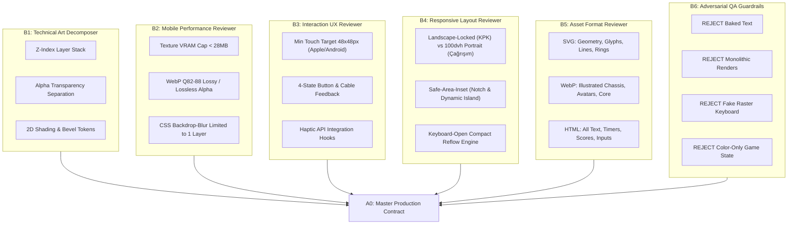

# GLIX — Production Asset Breakdown Specification

**Sprint:** Stage 11 — Production Asset Breakdown Sprint  
**Branch:** `stage-11-production-asset-breakdown`  
**Base Branch:** `stage-11-asset-exploration-sprint-01`  
**Official Art Direction:** **PREMIUM 2D ARCADE**  
**Runtime Target:** React 19 + Vite 6 + TypeScript PWA  
**Roles Integrated:** 2D Asset Technical Art Lead (B1) + Mobile Performance Reviewer (B2) + Interaction UX Reviewer (B3) + Responsive Layout Reviewer (B4) + Asset Format Reviewer (B5) + Adversarial QA (B6) + Lead Systems Architect (A0)  
**Document Status:** Production Handoff Specification (Authoritative)  
**Execution Guardrail:** Pure specification sprint. Zero writes to `apps/**`, `packages/**`, runtime CSS, or build configurations.

---

## 1. Executive Summary & Production Vision

GLIX has officially transitioned from experimental concept ideation to the **Premium 2D Arcade** visual architecture. The design goal is unequivocal:
When a player opens GLIX on iOS Safari or Android Chrome, the application must immediately evoke the tactile polish, snappy frame rates, and social excitement of a high-end arcade party game—**without incurring 3D runtime overhead, WebGL battery drain, or viewport fragility**.

This specification translates the four accepted / conditionally accepted visual concepts into strict production engineering contracts:

| Concept | Visual Reference | Decision | Production Transformation Required |
|---|---|:---:|---|
| **Kontrol Paneli Kaosu** | `docs/concepts/sprint01-console-defusal-core.jpg` | **KEEP** | Convert from monolithic 3D-looking render to layered 2D: flat-perspective chassis backplate, 4 standalone SVG/WebP cable tracks, decoupled HTML clue panel, and procedural spark FX. |
| **Common HUD System** | `docs/concepts/sprint01-hud-uikit-sheet.jpg` | **KEEP** | Implement 100% as responsive SVG + CSS + semantic HTML primitives. Zero raster HUD chrome. 60 FPS CSS transitions with strict reduced-motion fallbacks. |
| **Avatar System** | `docs/concepts/sprint01-avatar-visor-crew.jpg` | **KEEP WITH REFINE** | Refine proportions toward young-adult arcade streetwear (reduce chibi head-to-body ratio from 1:1.8 to 1:3.2). Strip baked names. Implement dual identifier system: high-contrast visor glyph + signature neon accent. Provide 3 discrete scale variants (Full, Bust, 32–48px HUD Pip). |
| **Çağrışım Ağı** | `docs/concepts/sprint01-cagrisim-synapse-core.jpg` | **KEEP IDEA, REFINE EXECUTION** | Abandon cinematic 3D globe depth. Implement flat 2D obsidian synapse reactor with SVG Bézier connection lines. Architect a mandatory **Keyboard-Open Compact Mode** using `100dvh` to ensure zero occlusion of word prompts or input fields on mobile. |

> [!IMPORTANT]
> **Sprint Scope Boundary:** Home Hero (`sprint01-home-kinetic-core.jpg`) and Primary Brand Logo (`sprint01-logo-chrome-neon.jpg`) are undergoing a separate parallel refinement sprint (`stage-11-home-logo-refinement`) and are intentionally **NOT** locked in this document.

---

## 2. Multi-Agent Synthesis (B1–B6 Architecture Review)



### Synthesis Consensus Matrix
1. **Zero Monolithic Canvas/WebGL:** Every game scene is composed as a CSS Grid / Flexbox viewport containing distinct Z-indexed layers.
2. **Text Sovereignty:** 100% of game-relevant text, clue instructions, timer counts, and player scores are standard DOM nodes (`<span>`, `<strong>`, `<p>`) styled with Google Fonts (`Plus Jakarta Sans` / `Outfit`) for localization, screen readers, and zero raster scaling artifacts.
3. **Accessibility Mandate:** No game mechanic may rely purely on color. Kontrol Paneli Kaosu wires feature embossed slot numbers (1–4), distinct braided textures, and textual labels. Avatars feature unique geometric visor glyphs (heart, arrow, wave, diamond, cross, bars, hazard, zig-zag) in addition to their signature hues.
4. **Mobile Thermal Budget:** Max 1 active `backdrop-filter: blur()` element on screen at any moment; box-shadow glows are limited to 2 concentric rings; particle effects default to CSS keyframe transforms, falling back to 0 on `prefers-reduced-motion: reduce`.

---

## 3. Section 1 — Kontrol Paneli Kaosu (Flagship Landscape Console)

### 3.1 Gameplay Context & Mechanical Anchor
- **Game ID:** `kontrol-paneli-kaosu`
- **Catalog Policy:** `supportsPortrait: false` (Strict Landscape Mini-Game; 10s tutorial, 45s defusal round).
- **Core Mechanic:** 2 to 8 players. Each player's screen displays a physical defusal console featuring 4 uniquely colored vertical cables (selected from blue, green, red, yellow). An encrypted clue panel displays instructions that describe *another player's* console (e.g., *"1. sırada kırmızı ve 3. sırada yeşil varsa sarı kablosunu kes"*). Players must communicate verbally across the room to identify their target and sever exactly one cable before the countdown expires.

### 3.2 Technical Layer Decomposition (Z-Index Stack)

```
[Z-10] Stage Backdrop (WebP) ── Dark indigo arena mezzanine with subtle structural gantry
  [Z-20] Console Chassis (WebP) ── Heavy matte graphite arcade console faceplate with recessed bays
    [Z-30] Cable Track Slots (SVG/CSS) ── 4 precision terminal sockets (top & bottom terminals)
      [Z-40] Layered Cable Sprites (WebP Alpha) ── 4 independent interactive cable columns
        [Z-50] Cut Sparks & Plasma FX (CSS/Canvas) ── Severance flash & trailing spark particles
      [Z-60] Clue Terminal Dock (CSS/HTML) ── 15° canted smoked glass plate with dynamic HTML text
    [Z-70] Selection Indicator / Snips Icon (SVG) ── Visual defusal reticle hovering over active wire
  [Z-80] Common Game HUD (SVG/HTML) ── Countdown timer bezel, round badge, pause/status
[Z-90] Result & Defusal Resolution Overlay (HTML/CSS) ── Success stamp / Explosive short-circuit callout
```

### 3.3 Layer Contract Specification

| Layer ID | Visual Element | Implementation Medium | File Path (Proposed) | Dimensions | Size Budget | Alpha | States Supported | Interaction Responsibility |
|---|---|---|---|---|:---:|:---:|---|---|
| **KPK-L01** | Stage Backdrop | Raster WebP | `assets/stage/landscape-arena-deck-v1.webp` | 1920×1080 | < 180 KB | No | Default idle | Passive environment background |
| **KPK-L02** | Console Chassis | Raster WebP | `assets/games/kpk-console-chassis-v1.webp` | 1920×1080 | < 240 KB | Yes (Cutout center) | Normal, Shake | Passive chassis surface; hosts mounting bays |
| **KPK-L03** | Terminal Clamp Sockets | SVG Path / CSS | Inline SVG Component | Responsive (48×32px per socket) | < 4 KB | Yes | Normal, Sparking | Visual wire anchor points at top and bottom |
| **KPK-L04** | Blue Cable (`mavi`) | WebP Alpha Sprite | `assets/games/kpk-wire-blue-v1.webp` | 120×720 (Asset) / 80×440 (DOM) | < 35 KB | Yes | Intact, Hover, Selected, Cut, Error | Primary touch target; dispatches cut intent |
| **KPK-L05** | Green Cable (`yeşil`) | WebP Alpha Sprite | `assets/games/kpk-wire-green-v1.webp` | 120×720 (Asset) / 80×440 (DOM) | < 35 KB | Yes | Intact, Hover, Selected, Cut, Error | Primary touch target; dispatches cut intent |
| **KPK-L06** | Red Cable (`kırmızı`) | WebP Alpha Sprite | `assets/games/kpk-wire-red-v1.webp` | 120×720 (Asset) / 80×440 (DOM) | < 35 KB | Yes | Intact, Hover, Selected, Cut, Error | Primary touch target; dispatches cut intent |
| **KPK-L07** | Yellow Cable (`sarı`) | WebP Alpha Sprite | `assets/games/kpk-wire-yellow-v1.webp` | 120×720 (Asset) / 80×440 (DOM) | < 35 KB | Yes | Intact, Hover, Selected, Cut, Error | Primary touch target; dispatches cut intent |
| **KPK-L08** | Cable Cut Reticle / Snips | SVG Vector | `assets/common/icons/snips-reticle-v1.svg` | 64×64 | < 3 KB | Yes | Hover, Armed, Cutting | Follows touch/mouse cursor along wire track |
| **KPK-L09** | Clue Terminal Card | CSS + SVG + HTML | Component (`<ClueTerminal />`) | 420×180 (Responsive) | < 5 KB (Code) | Yes | Normal, Decrypted, Expired | Renders `ownState.clueText` in crisp DOM text |
| **KPK-L10** | Severance Spark FX | CSS Keyframes / Particle Atlas | `assets/games/kpk-cut-sparks-atlas-v1.webp` | 512×512 (Atlas) | < 45 KB | Yes | Triggered on Cut (350ms duration) | Emits 12–16 radial spark sprites at severance point |
| **KPK-L11** | Defusal Result Stamp | CSS + SVG | Component (`<DefusalStamp />`) | 320×140 | < 6 KB | Yes | Success (`İMHA EDİLDİ`), Failure (`KABLO YANLIŞ`) | Post-round resolution banner with score delta |

### 3.4 Wire Interaction & Ergonomics Architecture
- **Touch Target Sizing:** Mobile ergonomics dictate that no player should mistakenly sever wire B while aiming for wire A. 
  - Each cable occupies a dedicated vertical corridor of `min-width: 68px` (computed CSS width: `18vw` in landscape).
  - Extended hit padding: `padding: 16px 20px` around each cable bounding box, resulting in an effective touch hitbox of `76×380px` (far exceeding the 48×48px mobile minimum).
  - Horizontal spacing: Minimum `24px` dead zone between adjacent wire hitboxes to prevent accidental multi-touch triggers.
- **State Machine for Cable Cut:**
  1. `IDLE / INTACT`: Cable sprite displays unbroken braided texture with soft edge specular highlight.
  2. `POINTER_DOWN / ARMED`: Wire receives `filter: brightness(1.25) drop-shadow(0 0 12px var(--wire-glow))`; haptic impulse `10ms` is fired (`navigator.vibrate(10)`).
  3. `SEVERED (Confirmed)`: 
     - Instantly swap sprite to severed variant (top and bottom wire segments pull back vertically by `12px` with a spring curve `cubic-bezier(0.175, 0.885, 0.32, 1.275)`).
     - Spawn Spark FX at severance coordinate `(X, Y)`.
     - Fire haptic pulse: `navigator.vibrate([25, 40, 25])`.
     - Disable all 4 wires (`pointer-events: none`).
     - Display state confirmation: *"1. KABLO KESİLDİ — DİĞERLERİ BEKLENİYOR"*.
  4. `ERROR / ALREADY_CUT`: If user attempts second interaction, wire vibrates horizontally with a 4px CSS shake (`stage-shake-err`).

### 3.5 Clue Panel Architecture
- **Location:** Docked in the upper-left quadrant of the console (`top: 12%`, `left: 6%`), angled at `15°` skew to simulate a recessed tactical CRT/OLED terminal.
- **Structure:**
  - Outer frame: Smoked acrylic bevel (`rgba(16, 22, 34, 0.88)` with `border: 1.5px solid rgba(0, 245, 255, 0.4)`).
  - Top header: Caution hazard stripe pattern (`repeating-linear-gradient(45deg, #FFD700 0, #FFD700 8px, #161B22 8px, #161B22 16px)`).
  - Inner display: Semantic `<div role="region" aria-label="Gizli İmha İpucu">`.
  - Font styling: `font-family: 'JetBrains Mono', monospace`, `font-size: clamp(13px, 1.4vw, 16px)`, `color: #00F5FF`, `line-height: 1.45`.
- **Zero Baked Text Validation:** The clue text is delivered live via WebSocket as `ownState.clueText`. The graphic asset is purely the empty, high-contrast frame.

### 3.6 Orientation Enforcement (Portrait Guard)
Because `kontrol-paneli-kaosu` requires broad landscape manipulation:
- If `window.matchMedia("(orientation: portrait)")` is true, the game canvas is hidden and `<RotateDeviceOverlay />` is mounted full-screen.
- The overlay features an animated SVG smartphone rotating 90 degrees with the label: *"KONTROL PANELİ İÇİN CİHAZINIZI YATAY ÇEVİRİN"*.

---

## 4. Section 2 — Common HUD System

### 4.1 Reusable HUD Primitives Overview
The GLIX HUD is a shared, responsive framework operating across all 24 mini-games. In keeping with the **Premium 2D Arcade** standard, HUD components must be **lightweight, crisp on retina displays, and decoupled from game mechanics**.

```
┌────────────────────────────────────────────────────────────────────────┐
│ [Round/Game Badge]      [GameTimer: Circular SVG]     [Self Avatar Pip]│
│  "TUR 3 / 5"               "00:18"                     "XP-01 (1,450p)"│
├────────────────────────────────────────────────────────────────────────┤
│                                                                        │
│                      Mini-Game Gameplay Stage                          │
│                                                                        │
├────────────────────────────────────────────────────────────────────────┤
│ [PlayerAvatarStrip: 8 Compact HUD Visors with Live Readiness Pips]    │
└────────────────────────────────────────────────────────────────────────┘
```

### 4.2 Primitive Component Contracts

#### 1. `GameTimer`
- **Implementation Medium:** Responsive SVG (`<circle>` with `stroke-dasharray` / `stroke-dashoffset`) + HTML countdown string.
- **Props Contract:**
  ```typescript
  interface GameTimerProps {
    readonly deadline: number | null;
    readonly now: number;
    readonly totalDurationSeconds?: number;
    readonly criticalThresholdSeconds?: number; // default: 5
    readonly size?: "compact" | "regular" | "prominent"; // 44px, 56px, 72px
  }
  ```
- **Responsive Behavior:** 
  - Portrait: Anchored at top-center, diameter `54px`.
  - Landscape: Anchored top-center or top-right, diameter `48px`.
- **Motion States:**
  - Normal (> 5s left): Smooth SVG perimeter drain with neon cyan/magenta stroke.
  - Critical (≤ 5s left): Stroke transitions to `#FF3366`; SVG pulses with `scale(1.08)` at 1 Hz; audio tick triggers.
  - Expired (0s): Flashes `#FF0055`, collapses to static tick mark.
- **Reduced Motion:** Disable pulsing scale; retain solid color shift and numerical countdown.

#### 2. `PlayerAvatarStrip`
- **Implementation Medium:** CSS Flexbox container hosting 2 to 8 `<AvatarPip />` SVG/WebP instances.
- **Props Contract:**
  ```typescript
  interface PlayerAvatarStripProps {
    readonly players: readonly MatchPlayerState[];
    readonly selfPlayerId: string | null;
    readonly currentTurnPlayerId?: string | null;
    readonly orientation?: "horizontal" | "vertical";
  }
  ```
- **Responsive Placement:**
  - Mobile Portrait: Pinned to bottom safe area (`bottom: max(12px, env(safe-area-inset-bottom))`), horizontal scrollable or auto-squishing rail (avatars sized at `36px` to fit 8 across 360px screen width).
  - Landscape: Pinned to upper right or far left vertical rail (`width: 52px`).
- **Readiness State Pips:** Beneath each avatar circle sits an SVG status pip:
  - Ready/Submitted: Solid Emerald `#00FF88`.
  - Acting / Current Turn: Pulsing Cyan `#00F5FF` with a rotating outer highlight ring.
  - Disconnected: Amber `#FFB800` with diagonal warning scanlines.
  - Eliminated: Translucent `#555555` with cross-out stroke.

#### 3. `RoundGameLabel`
- **Implementation Medium:** Pure semantic HTML with CSS gradient border.
- **Props Contract:** `{ gameName: string; roundCurrent: number; roundTotal: number; category: string }`.
- **Styling:** Smoked titanium pill (`rgba(22, 27, 34, 0.9)`), 1px cyan rim, micro-typography (`font-size: 11px; letter-spacing: 1.5px`).

#### 4. `ScoreDeltaPop`
- **Implementation Medium:** SVG icon + HTML score string (`+1 POINT`, `+3 COMBO`).
- **Motion States:** Spawns at action coordinate or center screen; animates `translateY(-24px) scale(1.15)` fading over `800ms` with easing `cubic-bezier(0.2, 0.8, 0.2, 1)`.
- **Reduced Motion:** Instant static display for `800ms` without translation.

#### 5. `ConnectionStateBadge`
- **Implementation Medium:** Compact 20×20px SVG radar beacon.
- **States:** Online (hidden or soft green), Reconnecting (pulsing amber dot + "Bağlanıyor…"), Offline (red badge + retry trigger).

#### 6. `TutorialOverlayFrame`
- **Implementation Medium:** Responsive modal dialog with smoked glass backing (`rgba(13, 17, 23, 0.94)` + `backdrop-filter: blur(16px)`).
- **Styling:** Top progress bar draining from 10s to 0s; animated SVG gameplay instruction loop; zero blocking interaction.

#### 7. `ResultOverlayFrame`
- **Implementation Medium:** Full-stage resolution sheet with SVG celebratory header, score delta table, and MVP podium badges.

#### 8. `RotateDeviceOverlay`
- **Implementation Medium:** Full-screen blocking SVG/CSS overlay for orientation-locked games.
- **Styling:** 48×48px SVG rotating phone with pulsating circular guidance arrows.

#### 9. `SelfPlayerBadge`
- **Implementation Medium:** Compact HUD card (`height: 38px`) displaying player's nickname, current match rank, and local score.

---

## 5. Section 3 — Avatar System (Visor Syndicate — 8 Players)

### 5.1 Character Identity & Proportional Refinement
The accepted concept `docs/concepts/sprint01-avatar-visor-crew.jpg` established the **Visor Syndicate** aesthetic: stylish young-adult arcade competitors wearing dark techwear jackets and illuminated digital visors.

#### Refinements from Concept to Production:
1. **Reduce Chibi / Preschool Proportions:** The original concept flirted with super-deformed/chibi proportions (head accounted for ~45% of total height). Production versions must adopt a **young-adult athletic arcade proportion** (head accounts for ~28–32% of total height; broader shoulders, articulated streetwear collars, sharp silhouettes).
2. **Strict Dual-Channel Differentiation:** To protect color-blind players and guarantee instant readability at 32px:
   - **Channel 1 (Color):** Signature neon rim and visor light.
   - **Channel 2 (Glyph Geometry):** Distinct mathematical / arcade glyph illuminated on the visor surface.
3. **No Baked Names:** Player nicknames and levels are dynamically rendered below or alongside the avatar in HTML.

### 5.2 The 8 Syndicate Roster Specifications

| Slot | Codename | Signature Accent Color | Visor Glyph | Visor Shape | Streetwear Silhouette | Personality Key |
|:---:|---|---|---|---|---|---|
| **P1** | **CYAN ARROW** | Neon Cyan (`#00F5FF`) | Directional Chevron (`▲`) | Hexagonal visor | Puffer jacket with high tactical collar | Agile speedster |
| **P2** | **MAGENTA HEART** | Hot Magenta (`#FF007F`) | Digital Heart (`♥`) | Oval visor | Cropped tech-hoodie with neon drawstrings | Bold, charismatic |
| **P3** | **AMBER BOLT** | Electric Amber (`#FFB800`) | Lightning Bolt (`⚡`) | Angular slit visor | Asymmetric bomber jacket with shoulder harness | Energetic risk-taker |
| **P4** | **LIME BARS** | Radiant Lime (`#39FF14`) | Equalizer Bars (`≡`) | Rectangular visor | Techwear track jacket with reflective piping | Analytical, precise |
| **P5** | **VIOLET WAVE** | Deep Violet (`#9D00FF`) | Sine Wave (`∿`) | Curvature visor | Oversized cowl-neck tunic | Mysterious strategist |
| **P6** | **ORANGE HAZARD** | Blaze Orange (`#FF5500`) | Hazard Stripe (`⚠`) | Faceted visor | Tactical utility vest with tool clips | Aggressive playmaker |
| **P7** | **EMERALD GEM** | Sharp Emerald (`#00FF88`) | Rhombus Diamond (`◆`) | Octagonal visor | Minimalist sleek windbreaker | Cool, composed |
| **P8** | **COBALT CROSS** | Electric Cobalt (`#0066FF`) | Target Cross (`✚`) | Round visor | Reinforced flight jacket with ribbed trim | Resilient anchor |

### 5.3 Scale Variants & Resolution Hierarchy

```
[Full Portrait] ── 384×512 WebP (Lobby Hero, Winner Podium, Match MVP Screen)
  [Bust Variant] ── 192×192 WebP (In-Game Voting Cards, Duel Choice Grids)
    [HUD Pip Variant] ── 48×48 SVG/WebP (Player Avatar Strip, In-Game Rail, Turn Indicator)
```

### 5.4 State Matrix Specifications

| State ID | Visor Rendering | Underfoot / Background Glow | Sprite Treatment | A11y Indicator |
|---|---|---|---|---|
| **ACTIVE / TURN** | Visor glyph pulses at 1.5 Hz (`brightness(1.4)`); inner glow expands | Radiant neon ring expanding outward (`transform: scale(1.1)`) | Full color, 100% opacity | Screen reader: *"Sıra sende / [Oyuncu] hamle yapıyor"* |
| **IDLE / WAITING** | Steady nominal glow (`brightness(1.0)`); clear glyph definition | Subtle 1px accent border | Full color, 100% opacity | Default visual presence |
| **SUBMITTED** | Green verification pip shines on visor corner | Static emerald underfoot disc | Full color, green check badge overlay | Screen reader: *"Cevap verildi"* |
| **DISCONNECTED** | Visor flickers with horizontal scanline noise; amber desaturation | Faded amber dashed boundary ring | 60% opacity, CSS amber tint filter | Screen reader: *"Bağlantı koptu"* + warning icon |
| **ELIMINATED** | Visor completely darkened with diagonal crack graphic; zero emissive glow | Dark gray cracked ring | 35% opacity, grayscale filter (`filter: grayscale(1)`) | Screen reader: *"Elendi"* + cross-out badge |
| **WINNER / MVP** | Visor shifts to prismatic golden shimmer (`#FFD700`); crown glyph flash | Golden particle halo with upward light shafts | Scale 1.08, high saturation | Screen reader: *"Maç Galibi"* + trophy badge |

### 5.5 Architectural Options: Recommended vs. Fallback

#### Recommended Architecture: Hybrid System (WebP Bust/Full + SVG HUD Pips)
- **Structure:**
  - Full-body and bust variants are served as **8 standalone transparent WebP files** (`assets/avatars/full/p1-cyan.webp`, etc.).
  - HUD Pips (32–48px) are implemented as **pure inline SVG components** containing the jacket collar path, helmet silhouette, and glowing vector glyph.
- **Why this wins on mobile:**
  - WebP compression for painted illustrative streetwear preserves rich texture without giant SVG DOM trees.
  - SVG for HUD pips guarantees pixel-perfect vector sharpness at small scale (32px, 36px, 44px) without downsampling blur.
  - Memory consumption: 8 WebP files @ ~35 KB = 280 KB total network payload; VRAM footprint is under 4 MB.
  - Zero sprite-sheet coordinate calculation bugs or bleeding pixels on fractional retina viewports.

#### Fallback Architecture: Single 2048×1024 WebP Sprite Atlas
- **Structure:** All 8 avatars and their bust variants packaged onto a single grid atlas (`assets/avatars/visor-syndicate-atlas-v1.webp`).
- **Trade-off:** Single HTTP request, but consumes 8.4 MB of GPU uncompressed VRAM simultaneously and requires CSS background-position calculations that can bleed edges on high-DPI displays. Retained as an emergency fallback if HTTP/2 multiplexing is constrained.

---

## 6. Section 4 — Çağrışım Ağı (Flagship Portrait Word Reactor)

### 6.1 Gameplay Context & Mechanical Anchor
- **Game ID:** `cagrisim-agi`
- **Catalog Policy:** `supportsPortrait: true` (Portrait-First Social Party Game; 10s tutorial, 20s submission round).
- **Core Mechanic:** 2 to 8 players. A central stimulus word (e.g., `"DENİZ"`) is revealed. Each player privately types their immediate first association (e.g., `"KUM"`, `"BALIK"`, `"MAVİ"`). Players who input matching words form neural synapses and score points proportional to the size of their matching cluster.

### 6.2 Technical Layer Decomposition (Z-Index Stack)

```
[Z-10] Background Backdrop (WebP) ── Dark indigo arena with subtle radial synaptic nebula
  [Z-20] Synaptic Connection Network (SVG Canvas) ── Dynamic Bézier curves from reactor to nodes
    [Z-30] Central Word Reactor (WebP Alpha + CSS Glow) ── Obsidian sphere with electric cyan/violet arcs
      [Z-40] Stimulus Word Display (HTML) ── Crisp glowing word header anchored to reactor pedestal
    [Z-50] Peripheral Player Nodes (SVG/HTML) ── 2 to 8 avatar tokens positioned radially
  [Z-60] Interactive Input Console (HTML/CSS) ── Tactical typewriter bay housing native <input>
[Z-70] Result Neural Synapses & Clustered Ribbons (SVG) ── Highlighted golden energy paths for matches
```

### 6.3 Layer Contract Specification

| Layer ID | Visual Element | Implementation Medium | File Path (Proposed) | Dimensions | Size Budget | Alpha | States Supported | Interaction Responsibility |
|---|---|---|---|---|:---:|:---:|---|---|
| **CGA-L01** | Stage Backdrop | Raster WebP | `assets/stage/portrait-arena-deck-v1.webp` | 1080×1920 | < 160 KB | No | Default idle | Passive background atmosphere |
| **CGA-L02** | Synaptic Line Canvas | Responsive SVG (`<path>`) | Component (`<SynapseNetwork />`) | Viewport Dynamic (100% × 100%) | < 6 KB (Code) | Yes | Idle, Pulsing, Connected, Clustered | Dynamic Bézier curves connecting center to player nodes |
| **CGA-L03** | Central Word Reactor | Raster WebP Alpha | `assets/games/cagrisim-reactor-core-v1.webp` | 512×512 | < 75 KB | Yes | Normal, Pulsing, Overload | Visual anchor; CSS rotation and breathing glow |
| **CGA-L04** | Stimulus Word Banner | HTML + CSS Text | Component (`<ReactorWord />`) | Responsive (max-width: 80vw) | < 2 KB (Code) | Yes | Normal, Reveal, Resolved | Displays `publicState.mainWord` in high-contrast neon |
| **CGA-L05** | Player Peripheral Nodes | SVG + WebP Avatar Pip | Component (`<PlayerNode />`) | 48×48px per node | < 4 KB each | Yes | Waiting, Submitted, Matching, Solitary | 2 to 8 player anchor positions around reactor |
| **CGA-L06** | Tactical Input Deck | CSS + SVG Frame | Component (`<AssociationInputDeck />`) | Responsive (100% width × 140px) | < 8 KB | Yes | Default, Focused, Submitted, Disabled | Houses real HTML input and submit action |
| **CGA-L07** | Native HTML Input | Semantic HTML `<input>` | `<input className="cagrisim-input" />` | 280×48px | 0 KB (DOM) | Yes | Empty, Valid, Locked | Native touch input; auto-capitalizes Turkish |
| **CGA-L08** | Result Matching Ribbons | SVG Path + CSS Dash | Inline SVG Overlay | Viewport Dynamic | < 5 KB (Code) | Yes | Result phase only | Thick golden glowing ribbons bridging matching nodes |

### 6.4 The Mobile Virtual Keyboard Challenge & Compact Mode Engine
When a player focuses the input field on iOS Safari or Android Chrome, the mobile software keyboard slides up, consuming **40% to 55% of total screen height**. On standard web apps, this causes horrific scrolling, hidden inputs, and clipped gameplay graphics.

#### The `100dvh` Viewport Contract:
- The game container utilizes CSS `height: 100dvh` with `overflow: hidden; position: fixed; inset: 0;`.
- A resize listener binds to `window.visualViewport`:
  ```typescript
  const isKeyboardOpen = window.visualViewport.height < window.innerHeight * 0.72;
  ```

#### Layout Mode Reflow Matrix:

```
+───────────────────────────────+      +───────────────────────────────+
|      DEFAULT MODE (100dvh)    |      |   KEYBOARD-OPEN COMPACT MODE  |
|                               |      |                               |
|       [Game HUD / Timer]      |      | [HUD: Compact Timer + Word]   |
|                               |      |  "DENİZ" ── 14s               |
|      (P1)     (P2)     (P3)   |      |                               |
|         \      |      /       |      | [Mini Node Strip: 8 Avatars]  |
|          [WORD REACTOR]       |  =>  |  (P1) (P2) (P3) (P4) (P5)     |
|          512px Orb (240px)    |      |                               |
|            "DENİZ"            |      | [Reactor Orb: Collapsed 80px] |
|         /      |      \       |      |                               |
|      (P4)     (P5)     (P6)   |      | [TACTICAL INPUT FIELD]        |
|                               |      |  [ MAVİ DALGA           ] [OK]|
|    [ Tactical Input Deck ]    |      +───────────────────────────────+
|    [ MAVİ             ] [OK]  |      |                               |
|                               |      |     VIRTUAL KEYBOARD          |
|                               |      |      (iOS / Android)          |
+───────────────────────────────+      +───────────────────────────────+
```

1. **Default Mode (Keyboard Closed):**
   - Reactor sphere renders at `220px` diameter in upper-middle tier.
   - Player nodes (2–8) are arranged in an elliptical orbital ring around the reactor.
   - Dynamic SVG Bézier curves connect the reactor to each node.
   - Input deck rests comfortably in lower third above bottom safe area.
2. **Keyboard-Open Compact Mode:**
   - Reactor sphere smoothly scales down to `84px` and shifts to upper edge (`transform: scale(0.38) translateY(-60px)`).
   - Peripheral player nodes collapse into a slim horizontal status bar (`height: 36px`) docked just below the HUD timer.
   - The stimulus word (`publicState.mainWord`) docks directly above the input box in high-contrast cyan banner text.
   - The native input box pins exactly `8px` above the virtual keyboard surface (`bottom: 0` relative to `visualViewport`).
   - **Zero Occlusion Guarantee:** Both the stimulus word, input field, and submit button remain 100% visible without user scrolling.

### 6.5 Dynamic Node Topology (2 to 8 Players)
The SVG connection lines are computed analytically from screen coordinates:
- Center coordinates: `(Cx, Cy)` derived from reactor bounding rect.
- Player coordinates: `(Px[i], Py[i])` calculated using an elliptical perimeter function:
  $$Px_i = Cx + Rx \cdot \cos(\theta_i), \quad Py_i = Cy + Ry \cdot \sin(\theta_i)$$
  where $\theta_i = \frac{2\pi \cdot i}{N} - \frac{\pi}{2}$, $Rx = 0.38 \cdot W$, $Ry = 0.26 \cdot H$.
- Curve path: Cubic Bézier `<path d="M Cx Cy Q ControlX ControlY Px Py" />` with subtle curve sagging for an organic synaptic cable look.

---

## 7. Section 5 — Adversarial QA Audit & Rejection Log (B6 Gate)

The Adversarial QA reviewer (B6) systematically evaluated the accepted concepts against strict production rules. The following practices were explicitly **REJECTED** and mitigated:

```
[AUDIT GATE] ── ALL CHECKS EVALUATED AGAINST MOBILE RUNTIME STANDARDS
  [FAIL] Baked Text in Assets ─────────> REJECTED & PURGED (Moved to HTML/DOM)
  [FAIL] Monolithic Single Images ─────> REJECTED & SPLIT (Decomposed to layers)
  [FAIL] Fake Raster Keyboard ─────────> REJECTED & BANNED (Enforced native OS input)
  [FAIL] Unnecessary Canvas / WebGL ───> REJECTED (Zero 3D runtime overhead)
  [FAIL] Tiny Touch Targets (<44px) ───> REJECTED (Enforced ≥ 48px hitboxes)
  [FAIL] Color-Only Game States ───────> REJECTED (Enforced Glyphs + Patterns)
  [FAIL] Excessive Stacked Blurs ──────> REJECTED (Capped at 1 blur layer)
  [FAIL] VRAM Spikes (>30MB) ──────────> REJECTED (Max raster 1080p, WebP q82)
```

### Detailed Rejection & Remedy Ledger

| Component | Rejected Pattern | Danger / Vulnerability | Required Production Remedy |
|---|---|---|---|
| **Kontrol Paneli Kaosu** | Baking cables directly onto the console background image | Makes wire cutting interaction impossible without redrawing the entire screen; prevents responsive layout reflow. | Console chassis is an empty backplate; 4 cables are independent interactive sprites positioned via CSS grid. |
| **Kontrol Paneli Kaosu** | Monolithic 3D render with baked lighting, dials, and text | Inflexible, non-localizable, heavy file payload (>2 MB). | 2D illustrated matte chassis (< 240 KB WebP); clue text rendered in HTML; buttons powered by CSS tokens. |
| **Kontrol Paneli Kaosu** | Wires differentiated only by red, green, blue, yellow color | Completely inaccessible to protanopia and deuteranopia color-blind players. | Wires feature embossed numbered slots (1, 2, 3, 4), distinct braided texture patterns, and text labels. |
| **Çağrışım Ağı** | Concept visual showing a fake rendered typewriter keyboard on screen | Confuses players; on touch devices, the OS keyboard pops up anyway, covering the fake graphic and breaking the UI. | Fake keyboard graphic completely purged. Clean 2D tactical pedestal with standard HTML input that bridges to native keyboard. |
| **Çağrışım Ağı** | Deep cinematic 3D globe with perspective distortion | Heavy WebGL or large sprite sequence required; distracts from fast 20s word association gameplay. | Flat 2D obsidian synapse reactor with SVG Bézier connection lines and lightweight CSS breathing glow. |
| **Avatar System** | Chibi 1:1.8 proportions and baked player names in sprite | Childish tone conflicting with Young-Adult arcade direction; hardcodes names that should come from multiplayer server. | Proportions corrected to 1:3.2 athletic techwear; names stripped from assets and dynamically rendered in HTML. |
| **Common HUD** | Rasterizing the timer ring and score popups as GIF/APNG | Scaling artifacts on modern 3x/4x retina mobile screens; rigid timing impossible to pause or synchronize. | 100% vector SVG timer with `stroke-dashoffset` driven by client timestamp delta; dynamic HTML score counters. |
| **Performance** | Multiple nested `backdrop-filter: blur(20px)` and stacked `drop-shadow` filters | Drops frame rate to < 20 FPS on mid-tier Android phones (Mali GPU) and causes severe thermal throttling on iOS. | Maximum 1 active `backdrop-filter` per scene; CSS box-shadow glow capped at 2 concentric layers; blur capped at 12px. |

---

## 8. Section 6 — Final Architecture Decisions & Next Steps

1. **Production Branch Created:** `stage-11-production-asset-breakdown` branched from `stage-11-asset-exploration-sprint-01`.
2. **Companion Documents Generated:**
   - `docs/GLIX_ASSET_EXPORT_CONTRACT.md` — Authoritative export contract, path map, responsive breakpoints, state tables, and performance budgets.
   - `docs/GLIX_PRODUCTION_ASSET_PROMPTS.md` — Deterministic production generation prompts for all asset layers with explicit negative blocks.
3. **Runtime Preservation Notice:** Zero modifications made to `apps/client`, `packages/shared`, server engines, or build tooling. The production codebase remains completely clean and ready for implementation upon asset generation sign-off.
